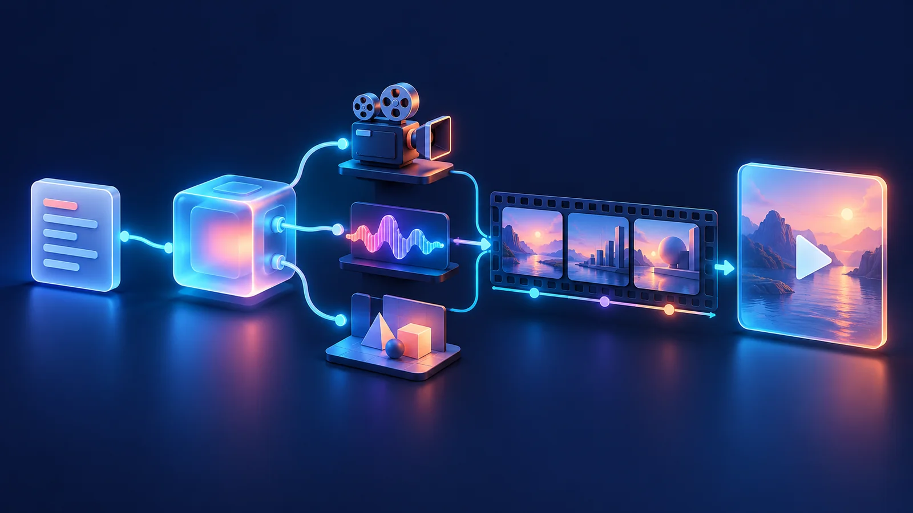
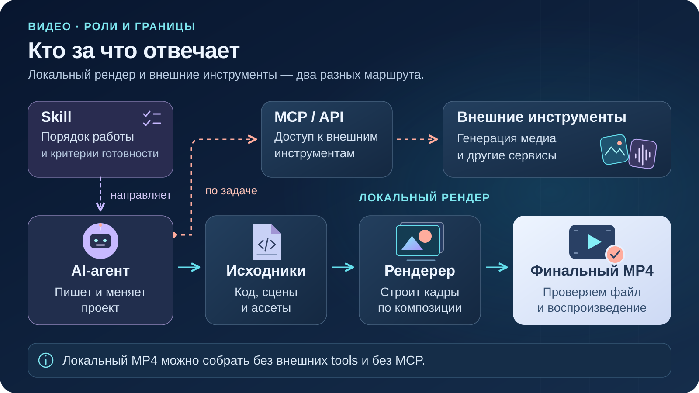
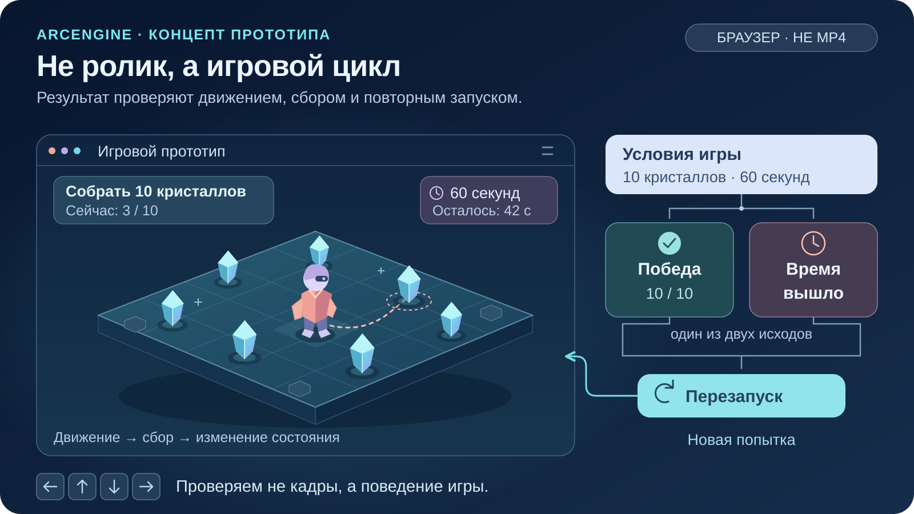

<!--
{
  "draft": false,
  "tags": ["Программирование"]
}
-->

# MCP для видеогенерации: от промпта до готового ролика

```blogEnginePageDate
01 ноября 2026
```

Под «сделать видео» скрываются разные задачи: написать motion-графику кодом, сгенерировать клип из текста
или картинки, смонтировать существующую съёмку, добавить музыку и речь.



## Оглавление

- [Сначала выбрать результат](#routes)
- [Remotion, HyperFrames и Motion: что выбрать](#video-tools)
- [Skills и библиотеки: кто за что отвечает](#skills)
    - [Rivera Motion Free: сначала согласовать, потом рендерить](#rivera-motion)
    - [Vizavi Motion: сцены, стыки и проверка выдачи](#vizavi-motion)
    - [opus-video-skills: кодовые шаблоны](#opus-video-skills)
- [Как использовать референсы](#references)
- [HyperFrames: локально или через MCP](#hyperframes)
    - [Локальный путь: композиция → preview → MP4](#hyperframes-local)
    - [Hosted MCP: рендер на стороне HeyGen](#hyperframes-hosted)
- [Генеративные клипы, голос и музыка](#media)
    - [Polza: административный MCP отдельно от Media API](#polza)
    - [ElevenLabs](#elevenlabs)
    - [SunoAI](#suno)
- [Blender: управляемая 3D-сцена и монтаж](#blender)
- [ArcEngine: разработка игр с AI-агентом](#arcengine)

<a id="routes"></a>

## Сначала выбрать результат

Для заставки с интерфейсом и точными надписями разумно начать с кодовой анимации. Если нужен реалистичный
эпизод, которого нет в исходниках, рассмотреть text-to-video или image-to-video. Если уже есть съёмка,
сначала поставить монтажную задачу: отобрать дубли, обрезать, соединить, добавить титры и звук.

| Нужный результат                                  | Подходящий маршрут                                                 |
|---------------------------------------------------|--------------------------------------------------------------------|
| UI, схемы, типографика, продуктовая заставка      | Локальный HyperFrames или Remotion; агент пишет композицию         |
| Новый клип из текста или изображения              | Генеративная модель через Media API, например Polza (Veo, SeaDance |
| Контролируемая 3D-сцена или монтаж готовых клипов | Blender, его рендер и видеоредактор                                |
| Озвучка или музыкальная дорожка                   | ElevenLabs TTS, Suno; затем сборка с изображением                  |

<a id="video-tools"></a>

## Remotion, HyperFrames и Motion: что выбрать

Это инструменты разных уровней, а не четыре взаимозаменяемых MCP-сервера.

| Инструмент                                                            | Что делает                                                    | Как помогает с роликами                                                                                                 |
|-----------------------------------------------------------------------|---------------------------------------------------------------|-------------------------------------------------------------------------------------------------------------------------|
| [Remotion](https://www.npmjs.com/package/remotion)                    | Видео через React-компоненты                                  | Сцены, текст, изображения, видео и звук; управление временем, предпросмотр и рендер.                                    |
| [@remotion/three](https://www.npmjs.com/package/@remotion/three)      | Дополняет Remotion интеграцией с Three.js / React Three Fiber | Добавляет модели, камеры, свет и материалы; позволяет привязать 3D-анимацию к кадрам ролика.                            |
| [Framer Motion → Motion](https://www.npmjs.com/package/framer-motion) | Анимация React-интерфейсов                                    | Появления, перемещения, layout, жесты и scroll. Самостоятельно готовый MP4 не собирает.                                 |
| [HyperFrames](https://www.npmjs.com/package/hyperframes)              | Видео из HTML/CSS и управляемых анимаций                      | Композиция с таймингами и, например, GSAP-анимациями превращается в MP4. Пакет `hyperframes` — CLI; React не требуется. |

**Как выбирать.** Если уверенно работаете с React, начните с
Remotion; [@remotion/three](https://www.remotion.dev/docs/three)
добавляйте при необходимости настоящего 3D. Если привычнее HTML/CSS/JavaScript — рассмотрите HyperFrames.
Remotion и HyperFrames обычно выступают альтернативными основами проекта, а [Motion](https://motion.dev/docs/react)
нужен прежде всего для анимации самого сайта или приложения.

Remotion или HyperFrames подходят для текста, иллюстраций, параллакса и звука. Действия персонажей для полноценного
мультфильма нужно спроектировать или сгенерировать отдельно: сборка ролика не заменяет работу над движениями персонажа.

**Коммерческое использование разрешено у всех четырёх, но условия разные:**

- **Remotion:** [Free License](https://github.com/remotion-dev/remotion/blob/main/LICENSE.md) разрешает коммерческие
  ролики физическим лицам и компаниям до трёх сотрудников включительно. Более крупным коммерческим организациям нужна
  Company License; есть исключения, например для некоммерческих организаций. Считается размер всей компании, не только
  видеокоманды.
- **@remotion/three:** у самого пакета MIT, но он использует Remotion и не отменяет требований к его лицензированию.
- **Motion:** [MIT](https://github.com/motiondivision/motion/blob/main/LICENSE.md), включая коммерческие закрытые
  проекты.
- **HyperFrames:** [Apache 2.0](https://github.com/heygen-com/hyperframes/blob/main/LICENSE), без ограничения размера
  компании.

Проверяйте лицензию используемой версии. Платные дополнения, облачный рендер, API и права на музыку, шрифты
и изображения — отдельные вопросы: свободная лицензия кода не делает все материалы и вычисления бесплатными.

<a id="skills"></a>

## Skills и библиотеки: кто за что отвечает



<a id="rivera-motion"></a>

### Rivera Motion Free: сначала согласовать, потом рендерить

[Rivera Motion Free в Google Drive](https://drive.google.com/drive/folders/1SnSP0RVjHSlRw6JEktycw3RDQBEdqmJ7)
— skill для кодовой анимации на Remotion. Полезный принцип автора: согласовать словами замысел, затем ключевые кадры,
короткий тест и только потом полный рендер. В
описании [урока Георгия Риверы](https://www.youtube.com/watch?v=AIHViECQwiU&t=377s) отдельно разделены анимация кодом
и добавление реалистичных сцен, голоса и музыки через внешние модели Polza.

<a id="vizavi-motion"></a>

### Vizavi Motion: сцены, стыки и проверка выдачи

В [публичном уроке автора](https://vizavi.academy/lesson-motion/) удобно отдельно выбирать стиль и глубину сцены:
плоскую 2D-графику, слоистый параллакс или настоящее 3D. Они требуют разной реализации, а не только разных эффектов. Из
пакета полезно взять проектирование обеих сторон перехода, короткую пробу главного риска, общие акценты
изображения и звука, доработку первой сборки и проверку конечного MP4.

<a id="opus-video-skills"></a>

### opus-video-skills: кодовые шаблоны

В [opus-video-skills](https://github.com/tuzhechen2005/opus-video-skills) есть два направления:

- `painted-animation` — рисованная анимация на p5.js/p5.brush;
- `kinetic-reel` — типографика на Canvas со слоями Three.js.

Это skills с кодовыми шаблонами: Chrome строит кадры, FFmpeg собирает MP4. В `kinetic-reel` изображение и процедурный
звук опираются на общий `cues.js`, что помогает согласовать события. Лицензия кода — MIT.

<a id="references"></a>

## Как использовать референсы

Из референса нужны наблюдаемые правила: композиция, палитра, камера, темп, вход объектов, время чтения.

- [Paperclip в mg-styles-15](https://vincentwei1021.github.io/mg-styles-15/#19-paperclip)
- [Prompt Motion](https://prompt-motion.com/)
- [YouMind](https://youmind.com/ru-RU/opus-5-5-prompts/explore)

<a id="hyperframes"></a>

## HyperFrames: локально или через MCP

[HyperFrames](https://github.com/heygen-com/hyperframes) превращает HTML/CSS, медиа и управляемую анимацию в видео.

Для CLI [`hyperframes`](https://www.npmjs.com/package/hyperframes) нужны **Node.js 22+, Chrome/Chromium,
FFmpeg и FFprobe**. Минимальный старт по [CLI-документации](https://hyperframes.heygen.com/packages/cli):

```sh
npx hyperframes init mcp-video --non-interactive --skip-skills
```

Здесь `--skip-skills` оставлен намеренно: создание проекта не должно незаметно менять установку инструкций агента.
Отдельная команда `npx hyperframes skills update` обновляет skills.

<a id="hyperframes-hosted"></a>

## Генеративные клипы, голос и музыка

Если бриф требует новый реалистичный клип или озвучку, это отдельная производственная задача.

<a id="polza"></a>

### Polza: административный MCP отдельно от Media API

[Polza.ai](https://polza.ai/) — агрегатор моделей. Его официальный
[MCP Beta](https://polza.ai/docs/gaidy/mcp.md) документирован для управления аккаунтом: профиль, баланс,
организации, ключи, биллинг и история.

Генерация видео описана отдельно в [Media API](https://polza.ai/docs/api-reference/media/create.md)
и [гайде Veo](https://polza.ai/docs/gaidy/veo-3-1.md).

<a id="elevenlabs"></a>

### ElevenLabs

Текущий [hosted MCP ElevenLabs](https://elevenlabs.io/docs/eleven-agents/operate/hosted-mcp.md)
подтверждает **TTS**: текст превращается в речь с временной ссылкой на скачивание. Сервер также управляет
ElevenAgents; для озвучки не нужны широкие права изменения production-агентов.

<a id="suno"></a>

### SunoAI

[Подключение](https://suno.com/mcp) использует `https://api.suno.com/mcp`, вход в Suno и кредиты аккаунта.
Free — некоммерческий режим.

<a id="blender"></a>

## Blender: управляемая 3D-сцена и монтаж

[Blender Lab MCP](https://www.blender.org/lab/mcp-server/) - это официальный проект: отдельный сервер и add-on.

Есть еще сторонний `ahujasid/blender-mcp`.

Сервер предоставляет выполнение Python в Blender, сведения об объектах и файле, поиск по справке,
screenshots и preview-рендеры. Сам Blender умеет рендерить анимацию и
[монтировать готовые клипы со звуком](https://docs.blender.org/manual/en/latest/video_editing/index.html).
Это подходящий маршрут для контролируемой геометрии, камеры и сборки,

<a id="arcengine"></a>

## ArcEngine: разработка игр с AI-агентом

Это смежный интерактивный маршрут: результат — браузерная игра, не сгенерированный видеоклип.

**[ArcEngine](https://github.com/xaidan777/ArcEngine)** — стартовый набор для браузерных 3D-игр,
спроектированный под LLM-кодинг. Агент пишет JavaScript, а готовая основа на **Babylon.js** даёт сцену,
камеру, свет, тени, загрузку моделей, звук и редактор. Это не самостоятельная нейросеть, генерирующая игру
по кнопке, и **не MCP-сервер**: работа идёт через файлы игрового проекта.

Идея автора — не учить агента управлять большим интерфейсом движка, а дать небольшой проект с понятными
правилами. Логику меняет агент, а объекты, параметры, звук и UI можно донастраивать в веб-редакторе.
Авторский [анонс](https://t.me/tearevo/339) и [демонстрация](https://www.youtube.com/watch?v=QpsV96WBWBA).
Речь именно о `xaidan777/ArcEngine`, не об одноимённом Python-движке ARC Prize.



Пример промпта:

```text
Работай в этой папке ArcEngine. Сначала прочитай README.md, CLAUDE.md
и нужные файлы из claude/skills/, составь короткий план и дождись согласия.
Не меняй движок и стек, не добавляй npm-зависимости без обсуждения.

Сделай браузерную 3D-игру: за 60 секунд собрать 10 кристаллов на одной карте.
Управление WASD, камера следует за персонажем. Нужны счётчик кристаллов,
таймер, победа, проигрыш по времени, перезапуск и выключение звука.
Сначала используй простую геометрию и существующие ассеты без платных API.
Проверь, что набор уже умеет, а что потребуется реализовать:
не считай физику, коллизии и контроллер игрока готовыми по умолчанию.

Соблюдай правила набора: логика — в Game.js, параметры — в Constants.js,
интерфейс — через UILayout.js и UI API, объекты получай по тегам.
Сначала реализуй минимальный цикл, затем займись внешним видом.
Запусти node tools/check.mjs и проверь игру в браузере:
движение, сбор, победу, тайм-аут, перезапуск и звук. Одного скриншота мало.
При правках рендера выполни Debug3D.lint(). Сообщи, что реально проверено,
а что заблокировано. Временные материалы складывай в .temp/.
```
