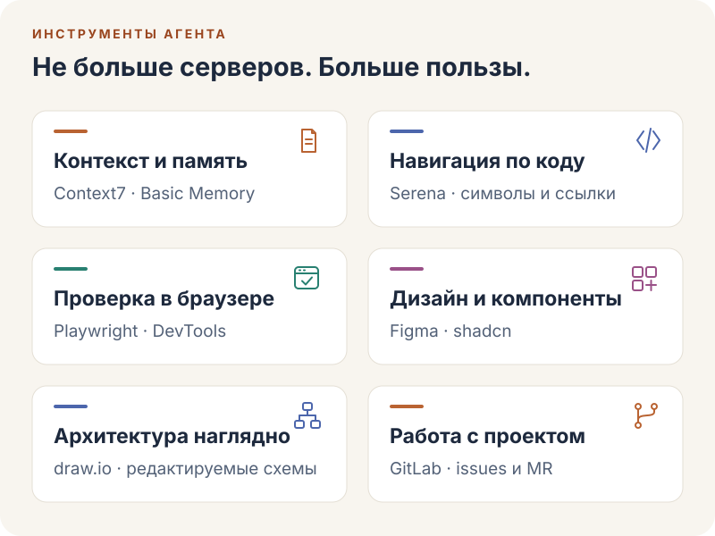
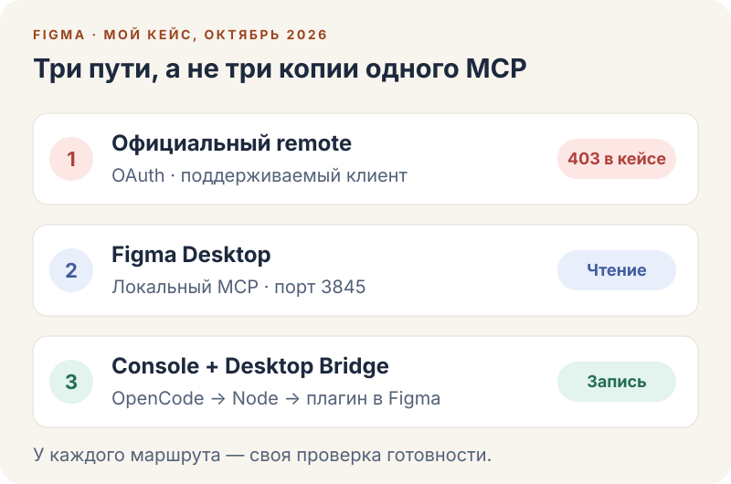
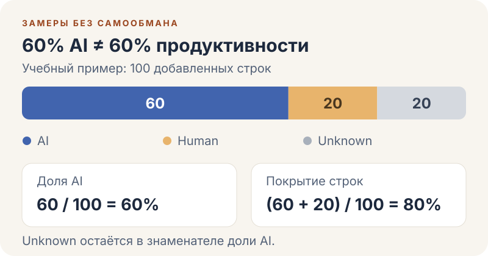

<!--
{
  "draft": false,
  "tags": ["Программирование"]
}
-->

# MCP и полезные AI-инструменты: от Figma до замеров

```blogEnginePageDate
25 октября 2026
```

Подключить агенту десяток инструментов — ещё не значит наладить работу. Нужно объяснить задачу, дать нужный доступ,
проверить результат и не перепутать красивые проценты с полезными изменениями. Здесь собрал свой набор MCP,
истории починки Serena и Figma, grill-me, OpenSpec, UX и замеры git-ai — с примерами подключения
и промптами для агента.

Это продолжение статьи [Vibe Coding — простыми словами](../Vibe%20Coding%20%E2%80%94%20Getting%20Started/index.html).

## Оглавление

- [MCP](#mcp)
    - [Basic Memory](#basic-memory)
    - [Context7](#context7)
    - [Serena](#serena)
    - [Playwright](#playwright)
    - [Chrome DevTools](#chrome-devtools)
    - [draw.io](#drawio)
    - [GitLab](#gitlab)
    - [shadcn](#shadcn)
    - [Figma — официальный remote](#figma)
        - [Figma Desktop](#figma-desktop)
        - [Figma Console](#figma-console)
    - [REA — Reverse Engineer Anything](#rea)
- [От идеи до проверяемого интерфейса](#planning)
    - [grill-me: вскрыть допущения до написания кода](#grill-me)
    - [OpenSpec: сохранить договорённости в проекте](#openspec)
    - [Проверка хорошего дизайна UX](#ux)
- [Наблюдаемость LLM](#llm-observability)
    - [git-ai](#git-ai)
    - [Langfuse](#langfuse)
    - [ccusage](#ccusage)

> **Если вы только начинаете:** подключите Context7 и Playwright.

---

<a id="mcp"></a>

## MCP

**MCP — стандартный способ подключить AI-приложение к данным и действиям.** Host — само приложение, например OpenCode.
Client — его компонент для связи с конкретным сервером. Server предоставляет возможности и может работать локально.
([Архитектура MCP](https://modelcontextprotocol.io/docs/2026-07-28/learn/architecture))



Сервер может предоставлять **tools** — операции, **resources** — данные для контекста и **prompts** — шаблоны
взаимодействия. MCP описывает интерфейс, **skill** объясняет порядок работы, **CLI** выполняет команды в терминале.
Это разные, дополняющие друг друга вещи.
([Понятия MCP](https://modelcontextprotocol.io/docs/2026-07-28/learn/server-concepts), [Agent Skills](https://agentskills.io/what-are-skills))

Все JSON-примеры ниже — **для OpenCode V2**, файл `opencode.jsonc` в корне проекта, но по аналогии можно применить к
любой другой система AI.

<a id="basic-memory"></a>

### Basic Memory

**Описание.** [`basic-memory`](https://github.com/basicmachines-co/basic-memory) — долговременные Markdown-заметки,
поиск и связи между знаниями. Но автоматическое воспоминание обо всех чатах - нет. Для локального варианта нужны `uv`
и Python 3.12+; до первой записи нужно выбрать проект базы знаний и место хранения заметок.
([Quickstart](https://docs.basicmemory.com/raw/start-here/quickstart-local.md))

Подключение через промпт

```text
Подключи Basic Memory MCP к этому проекту OpenCode V2 по официальной
инструкции basicmachines-co/basic-memory. Проверь uv и Python 3.12+;
используй запуск uvx basic-memory mcp. Сохрани существующий конфиг.
После согласования изменений проверь connected и получи список проектов
базы знаний. Ничего не записывай: проект и первую заметку я выберу отдельно.
```

Подключение через JSON

```json
{
  "mcp": {
    "servers": {
      "basic-memory": {
        "type": "local",
        "command": [
          "uvx",
          "basic-memory",
          "mcp"
        ]
      }
    }
  }
}
```

Адаптация - попроси агента (возможно в твоем Harness это уже настроено автоматически)

```
Cделай, чтобы Basic Memory заранее читал заметки пред стартом размышлений\джиалога, а после ответа записывал в память 
если в диалоге есть важные решения или информация.
```

<a id="context7"></a>

### Context7

**Описание.** [`context7`](https://github.com/upstash/context7) подтягивает документацию библиотек и примеры
с учётом версии. Помогает не опираться только на устаревшие знания модели.

Подключение через промпт

```text
Добавь Context7 в проектный OpenCode V2 как remote MCP:
https://mcp.context7.com/mcp. Сохрани другие настройки и согласуй diff.
Если потребуется вход, предложи мне авторизацию через /mcps.
Проверь подключение и найди документацию одной зависимости из package.json,
указав её установленную версию. Ссылку на полученный источник покажи в ответе.
```

Подключение через JSON

```json
{
  "$schema": "https://opencode.ai/config.json",
  "mcp": {
    "servers": {
      "context7": {
        "type": "remote",
        "url": "https://mcp.context7.com/mcp"
      }
    }
  }
}
```

<a id="serena"></a>

### Serena

**Описание.** [`serena`](https://github.com/oraios/serena) работает с кодом на уровне IDE (AST дерево вместо grep):
символы, ссылки, точечные изменения и рефакторинг. Language server — один из backend; его зависимости зависят от языка
проекта. Для показанного запуска сначала нужны `uv tool install -p 3.13 serena-agent` и `serena init`.
([Установка](https://oraios.github.io/serena/02-usage/010_installation.html),
[контекст ide](https://oraios.github.io/serena/02-usage/030_clients.html#terminal-based-clients))

Подключение через промпт

```text
Подключи oraios/serena к проектному OpenCode V2. Проверь установленный
serena CLI; его установку через uv согласуй отдельно. Запускай MCP
с контекстом ide и проектом текущего workspace, не соседнего репозитория.
После согласования diff проверь connected, прочитай initial instructions
Serena и найди существующий символ с его ссылками. Код не изменяй.
Onboarding и дополнительные установки сначала предложи, не запускай молча.
```

Подключение через JSON

* Если OpenCode не видит `serena` в PATH, замените первый элемент `command` абсолютным путём к CLI.

```json
{
  "mcp": {
    "servers": {
      "serena": {
        "type": "local",
        "command": [
          "serena",
          "start-mcp-server",
          "--context",
          "ide",
          "--project",
          "."
        ],
        "cwd": ".",
        "timeout": {
          "startup": 60000
        }
      }
    }
  }
}
```

Адаптация. Разбираясь с Serena на Windows, заметил что часто открываются окна и создается много процессов. Поэтому
я попросил агента

```
Починить Serena 1.7.0 на Windows: при старте открываются окна и плодятся процессы.

Причина — дефолты Serena: `web_dashboard_open_on_launch: true` и `web_dashboard_interface: app` (на Windows это 
pywebview-окно + своя tray-иконка на каждый экземпляр). OpenCode поднимает отдельный stdio-сервер на сессию, поэтому 
окон и процессов столько же, сколько сессий.

1. С бэкапом поправь `%USERPROFILE%\.serena\serena_config.yml`:
web_dashboard: true
web_dashboard_open_on_launch: false
web_dashboard_interface: tray_manager   # одна общая иконка вместо окна на инстанс
gui_log_window: false
Если дашборд не нужен — `web_dashboard: false`.

2. Убей только деревья процессов с корнем `serena.exe start-mcp-server` (корень + все потомки), не трогая остальные 
python/node, и перезапусти OpenCode целиком.

Проверка: после старта не открывается ни одного окна/вкладки; `SerenaDashboardTrayManager` ≤ 1; серверов не больше, 
чем активных сессий; вызов `get_current_config` работает.

Если остались короткие вспышки консоли — это `cmd.exe /c ...typescript-language-server`, который Serena поднимает 
на каждый активный проект; лечится числом открытых проектов и списком `languages` в `.serena/project.yml`.
```

<a id="playwright"></a>

### Playwright

**Описание.** [`playwright`](https://github.com/microsoft/playwright-mcp) проходит пользовательские сценарии: открыть
страницу, заполнить форму, проверить состояние.

Подключение через промпт

```
Подключи официальный microsoft/playwright-mcp в проектном OpenCode V2
через npx -y @playwright/mcp@latest. Проверь Node.js, npm и браузер;
недостающие установки предложи отдельно. Согласуй diff, сохрани другие MCP.
Для проверки открой https://example.com в новой вкладке и прочитай заголовок.
Не используй мои аккаунты и не закрывай существующие вкладки.
```

Подключение через JSON

```json
{
  "mcp": {
    "servers": {
      "playwright": {
        "type": "local",
        "command": [
          "npx",
          "-y",
          "@playwright/mcp@latest"
        ]
      }
    }
  }
}
```

<a id="chrome-devtools"></a>

### Chrome DevTools

**Описание.** [`chrome-devtools`](https://github.com/ChromeDevTools/chrome-devtools-mcp) нужен для диагностики: консоль,
сеть, скриншоты и performance traces живого Chrome. С Playwright возможности пересекаются; удобная специализация —
сценарии там, разбор причин ошибки здесь.

Подключение через промпт

```
Добавь ChromeDevTools/chrome-devtools-mcp в проектный OpenCode V2.
Проверь Node.js LTS и Chrome. В запуске отключи usage statistics и CrUX
флагами --no-usage-statistics и --no-performance-crux. Согласуй diff.
Проверь connected, открой example.com в новой вкладке, прочитай консоль
и сетевые запросы. Не подключай мой повседневный профиль без согласия.
```

Подключение через JSON

```json
{
  "mcp": {
    "servers": {
      "chrome-devtools": {
        "type": "local",
        "command": [
          "npx",
          "-y",
          "chrome-devtools-mcp@latest",
          "--no-usage-statistics",
          "--no-performance-crux"
        ]
      }
    }
  }
}
```

* Флаги отключают статистику сервера и запросы к CrUX, но не весь внешний трафик браузера.

<a id="drawio"></a>

### draw.io

**Описание.** [`drawio`](https://github.com/jgraph/drawio-mcp) создаёт редактируемые схемы архитектуры и потоков.
Здесь выбран локальный **Tool Server `@drawio/mcp`**, открывающий редактор. Есть еще альтернатива в виде
`mcp.draw.io` для работы с облачным drawio.

Подключение через промпт

```text
Подключи локальный draw.io Tool Server из jgraph/drawio-mcp
к проектному OpenCode V2: npx -y @drawio/mcp. Не подменяй его hosted
MCP App Server без обсуждения передачи данных. Покажи и согласуй diff.
Для проверки создай простую схему «Запрос → Проверка → Ответ»
без рабочих данных, открой её в редакторе и проверь возможность правки.
Промежуточные файлы сохраняй в .temp/.
```

Подключение через JSON

```json
{
  "mcp": {
    "servers": {
      "drawio": {
        "type": "local",
        "command": [
          "npx",
          "-y",
          "@drawio/mcp"
        ]
      }
    }
  }
}
```

<a id="gitlab"></a>

### GitLab

**Описание.** [`gitlab`](https://docs.gitlab.com/user/model_context_protocol/mcp_server/) даёт доступ к проектам,
issues и merge requests в пределах выданных прав. Ниже — **официальный сервер GitLab.com**. Для self-managed замените
домен, но MCP должен быть разрешён gitlab-группой и администратором.

Подключение через промпт

```text
Подключи официальный GitLab MCP к проектному OpenCode V2. Уточни адрес
инстанса и проверь разрешение на MCP. Используй endpoint /api/v4/mcp
и штатный OAuth, не проси токен в чат. Покажи diff и дождись подтверждения.
Предложи мне войти через /mcps, затем проверь connected и прочитай
метаданные указанного мной проекта. Не создавай issues, комментарии и MR,
не запускай pipelines. При 403 сообщи этап сбоя, не расширяй права наугад.
```

Подключение через JSON

```json
{
  "mcp": {
    "servers": {
      "gitlab": {
        "type": "remote",
        "url": "https://gitlab.com/api/v4/mcp"
      }
    }
  }
}
```

* OAuth-токен должен иметь scope `mcp`. Обычный legacy PAT со scope `api` для этого официального endpoint не подходит.

<a id="shadcn"></a>

### shadcn

**Описание.** [`shadcn`](https://ui.shadcn.com/docs/mcp) позволяет искать, просматривать и добавлять UI-компоненты
из совместимых реестров. Для установки компонентов нужен подходящий проект и `components.json`.

Подключение через промпт

```text
Добавь shadcn MCP к проектному OpenCode V2 по ui.shadcn.com/docs/mcp:
npx -y shadcn@latest mcp. Согласуй diff и сохрани остальные настройки.
Проверь подключение и получи список компонентов реестра.
Для добавления компонентов сначала проверь совместимость проекта
и components.json. Не меняй стек и не устанавливай компоненты без запроса.
```

Подключение через JSON

```json
{
  "mcp": {
    "servers": {
      "shadcn": {
        "type": "local",
        "command": [
          "npx",
          "-y",
          "shadcn@latest",
          "mcp"
        ]
      }
    }
  }
}
```

<a id="figma"></a>

### Figma — официальный remote

**Описание.** [`figma`](https://developers.figma.com/docs/figma-mcp-server/remote-server-installation/) — официальный
удалённый MCP: контекст дизайна и запись для поддерживаемых клиентов. Нужен вход в Figma.



Подключение через промпт

```text
Настрой официальный remote MCP Figma в проектном OpenCode V2:
https://mcp.figma.com/mcp. Сначала проверь текущую поддержку клиента Figma.
Покажи diff и дождись согласия. Если клиент поддерживается, предложи мне
войти через /mcps, затем получи контекст выбранного макета.
Если OAuth-регистрация возвращает 403, не обходи авторизацию:
зафиксируй ограничение и предложи варианты чтения или записи отдельно.
```

Подключение через JSON

```json
{
  "mcp": {
    "servers": {
      "figma": {
        "type": "remote",
        "url": "https://mcp.figma.com/mcp"
      }
    }
  }
}
```

Адаптация: OAuth-регистрация OpenCode возвращала 403. Это Figma ограничивает подключение поддерживаемыми клиентами.

Для чтения я оставил официальный Figma Desktop, для записи подключил сторонний Figma Console с Desktop Bridge.
Это другие маршруты с собственными правами и проверками, а не обход OAuth официального remote.

> Если у вас Cursor \ Codex \ Claude то скорее всего официальный Figma будет работать.

<a id="figma-desktop"></a>

#### Figma Desktop

**Описание.** [`figma-desktop`](https://developers.figma.com/docs/figma-mcp-server/local-server-installation/) —
официальный сервер внутри Figma Desktop: контекст макета, текущее выделение и скриншоты. Он не пишет на холст.
Включается через **Dev Mode → Enable desktop MCP server**; доступность зависит от плана и seat.

Подключение через промпт

```text
Подключи официальный Figma Desktop MCP к проектному OpenCode V2
по http://127.0.0.1:3845/mcp. Объясни, как включить сервер в Dev Mode,
и проверь требования плана. Покажи и согласуй diff существующего конфига.
После включения получи контекст выбранного мной элемента в открытом файле.
Не обещай запись на холст и не устанавливай сторонний плагин вместо
официального сервера без отдельного согласования.
```

Подключение через JSON

```json
{
  "mcp": {
    "servers": {
      "figma-desktop": {
        "type": "remote",
        "url": "http://127.0.0.1:3845/mcp"
      }
    }
  }
}
```

* Тип `remote` здесь означает HTTP-транспорт, хотя сервер находится на вашем компьютере.

Адаптация: для редактирования нужен другой маршрут

Если нужно только читать макет, desktop достаточно. В моём сценарии требовалось **рисовать на холсте**, поэтому
понадобился Figma Console с плагином. Включение порта 3845 не добавляет официальному desktop возможности записи
и не является обязательным шагом установки стороннего Desktop Bridge.
([Возможности официальных инструментов](https://developers.figma.com/docs/figma-mcp-server/tools-and-prompts/))

<a id="figma-console"></a>

#### Figma Console

**Описание.** [`figma-console`](https://github.com/southleft/figma-console-mcp/tree/v1.40.9) — сторонний сервер
`southleft/figma-console-mcp`; в моём кейсе использована версия **1.40.9**. Связка для записи:
OpenCode → локальный Node-сервер → WebSocket → Desktop Bridge в открытом Figma-файле.
PAT используется для REST-функций, действия на холсте идут через Plugin API.

Подключение через промпт

```text
Мне нужна запись на холст через southleft/figma-console-mcp и Desktop Bridge.
Для воспроизводимости описанного кейса используй 1.40.9. Объясни права
стороннего сервера и плагина, покажи план и diff; дождись подтверждения.
Установку вне проекта согласуй отдельно. Токен я передам через
FIGMA_ACCESS_TOKEN: не проси его в чат и не записывай в git.
Найди абсолютный путь к dist/local.js и настрой прямой запуск через node.
Дай шаги импорта manifest и запуска bridge в выбранном Figma-файле.
Проверь текущий инстанс: pluginConnected должен быть true.
После моего согласия создай тестовый фрейм и проверь его скриншотом.
Не чисти чужие процессы и не меняй существующие экраны ради теста.
```

Подключение через JSON

Воспроизводимый PowerShell-рецепт установки, **не запись моей первоначальной install-команды**:

```powershell
npm install --prefix "$HOME/.figma-console-mcp/server" figma-console-mcp@1.40.9
```

Нужны Node.js 18+ и Figma Desktop. Замените placeholder абсолютным путём к установленному `local.js`;
значение `FIGMA_ACCESS_TOKEN` заранее передайте в окружение процесса OpenCode.

```json
{
  "mcp": {
    "servers": {
      "figma-console": {
        "type": "local",
        "command": [
          "node",
          "<абсолютный путь к local.js>"
        ],
        "environment": {
          "FIGMA_ACCESS_TOKEN": "{env:FIGMA_ACCESS_TOKEN}"
        }
      }
    }
  }
}
```

В Figma Desktop: открыть файл → **Plugins → Development → Import plugin from manifest…** →
`~/.figma-console-mcp/plugin/manifest.json` → запустить **Figma Desktop Bridge**.
Проверка — `figma_get_status({ probe: true })` с `pluginConnected: true`.
После `figma_execute` — `figma_take_screenshot` и визуальная проверка.
Официальный `use_figma` и сторонний `figma_execute` — разные API.
([Настройка 1.40.9](https://github.com/southleft/figma-console-mcp/blob/v1.40.9/docs/setup.md))

Адаптация: прямой Node-запуск и восстановление связи с bridge

Точная первоначальная команда установки не сохранилась. Подтверждены локальный пакет и итоговый прямой запуск
`node .../node_modules/figma-console-mcp/dist/local.js`, не через `npx`: в этом Windows-окружении наблюдались
осиротевшие процессы. Это обходной путь конкретного случая, не общий запрет на `npx`.

При `no plugin connected` или бесконечном `Loading Figma Desktop Bridge…` я сверял текущий MCP-инстанс и порт,
разбирался с лишними экземплярами и заново открывал плагин. Проверкой стало `pluginConnected: true`, а не наличие
Node-процесса. Сверять нужно `transport.websocket.port`, открытый файл и импортированный manifest; при обновлении
учитывать кэш плагина.

В общем я пару раз просил его поправить, пока не добился работоспособности.

<a id="rea"></a>

### REA — Reverse Engineer Anything

**Описание.** [`rea`](https://github.com/morluto/rea) связывает агента со средствами исследования приложений:
декомпиляторами, анализом файлов и наблюдениями во время выполнения. Цель — получить доказательства поведения,
а не угадать устройство программы или восстановить исходники один в один.

В [ролике Swag](https://www.youtube.com/watch?v=5AhuSmReTOk) автор рассказывает об исследовании Screen Brush
и создании [ScreenInk](https://github.com/volyx/ScreenInk). Это его заявленный опыт, не мой эксперимент.

Подключение через промпт

```text
Подключи REA из morluto/rea к этому проекту OpenCode V2. Для примера
используй опубликованный rea-agents@6.8.0 и проверь требования Node.js.
Покажи проектный JSON с запуском MCP, сохрани остальные настройки.
Не запускай общий setup молча: он может менять пользовательские
конфиги и устанавливать skills; эти действия согласуй отдельно.
Проверь connected и каталог инструментов, затем доступность нужного
провайдера анализа. Целевую программу пока не запускай и не исследуй.
```

Подключение через JSON

Пример **для Windows**, по официальной форме launcher. Для Linux/macOS уберите `cmd.exe`, `/d`, `/c`.
У опубликованного `rea-agents@6.8.0` требования Node: **22.x ≥22.23.4, 24.x ≥24.22.1 либо ≥26.12.1**.
([Установка и ручная регистрация](https://github.com/morluto/rea/blob/main/docs/installation.md))

```json
{
  "mcp": {
    "servers": {
      "rea": {
        "type": "local",
        "command": [
          "cmd.exe",
          "/d",
          "/c",
          "npx",
          "-y",
          "rea-agents@6.8.0",
          "mcp"
        ]
      }
    }
  }
}
```

Нативный анализ требует отдельно подготовленного Hopper, Ghidra или IDA; статический JavaScript-анализ — нет.
Готовый MCP launcher не устанавливает все движки и не заменяет соответствующие workflow-инструкции.

Исследуйте только ПО, которое разрешено анализировать, с учётом лицензий и прав. REA не выдаёт лицензии на чужие
декомпиляторы. Локальный анализ также не означает, что результаты не попадут подключённой облачной модели.
([Ограничения проекта](https://github.com/morluto/rea#disclaimer))

---

<a id="planning"></a>

## От идеи до проверяемого интерфейса

**Когда читать:** агент умеет вызывать инструменты, но задача пока звучит как «сделай удобно».
Здесь три шага: обсудить решения, записать требования, проверить UX.

<a id="grill-me"></a>

### grill-me: вскрыть допущения до написания кода

**[grill-me](https://github.com/mattpocock/skills/blob/main/skills/productivity/grill-me/SKILL.md) от Matt Pocock** —
skill для уточнения плана, не MCP и не генератор кода. [README](https://github.com/mattpocock/skills#readme)
относит его к общим, не кодовым сценариям; здесь он полезен для проработки продуктовой идеи перед разработкой.

Агент строит **дерево решений**: ответ о пользователе определяет следующие вопросы о сценарии. В раунде задаёт вопросы,
предпосылки которых уже согласованы, предлагает рекомендации и ждёт ответов. Так последовательно вскрываются допущения,
а не выдаётся анкета на пятьдесят пунктов. **Факты о проекте агент проверяет сам; продуктовые решения принимает владелец
**. Реализация начинается только после подтверждения общего понимания.
([Механика интервью](https://github.com/mattpocock/skills/blob/main/skills/productivity/grilling/SKILL.md))

В проверенной версии `grill-me` — пользовательская точка входа: она вызывает `grilling`, поэтому хосту должны быть
доступны оба skill.

Точные команды из карточек skills.sh; вторая — для зависимого `grilling`, если он ещё недоступен хосту:

```sh
npx skills add https://github.com/mattpocock/skills --skill grill-me
```

Далее просто говорите:

```text
Примени grill-me. Хочу сделать ***.
```

<a id="openspec"></a>

### OpenSpec: сохранить договорённости в проекте

[OpenSpec](https://github.com/Fission-AI/OpenSpec/blob/v1.15.0/README.md) выносит требования из чата в версионируемые
файлы. Это CLI и рабочие инструкции для агента, **не MCP-сервер**.

```sh
npm install -g @fission-ai/openspec@1.15.0
openspec init
```

`init` предлагает интеграции с агентами и создаёт структуру проекта. Основной современный цикл:

* `/opsx:propose` → review человеком →
* → `/opsx:apply` → тесты и review →
* → `/opsx:archive`.

Пример:

```text
/opsx:propose add-code-copy
Добавь кнопку «Скопировать» у блоков кода.
```

* `add-code-copy` название таски, можно не указывать тогда система добавит название сама.

Получаем файлы:

* `proposal.md` объясняет зачем и что меняем;
* `specs` описывают поведение;
* `design.md` — технические решения, когда они нужны;
* `tasks.md` — задачи.

Важное различие: **`openspec/specs/` — текущие согласованные требования**, а `openspec/changes/add-code-copy/specs/` —
изменения требований ([Структура](https://openspec.dev/docs/setup)).

Человек читает план и уточняет сценарии: что произойдёт при запрещённом доступе к буферу, повторном клике, работе
с клавиатуры? Только затем отдельным запросом запускается `/opsx:apply add-code-copy`. После реализации — реальные
проверки и ревью, затем `/opsx:archive add-code-copy` с обновлением основных specs.

<a id="ux"></a>

### Проверка хорошего дизайна UX

В [докладе Михаила Проскурина «Минимально жизнеспособный дизайн: UX для каждого»](https://www.youtube.com/watch?v=Y6q7z3rbbgs)
эвристики Нильсена предлагаются как практическая проверка для фронтендера. Десять эвристик Jakob Nielsen, описаны в его
[статье](https://www.nngroup.com/articles/ten-usability-heuristics/).

| Принцип                      | Практические вопросы                                                                                   |
|------------------------------|--------------------------------------------------------------------------------------------------------|
| Видимость состояния          | Видно ли, что действие принято и выполняется? Понятен ли результат?                                    |
| Соответствие реальному миру  | Понятны ли слова пользователю без внутреннего жаргона? Соответствует ли порядок информации его задаче? |
| Контроль и свобода           | Можно ли выйти из сценария и отменить ошибочное действие? Сохраняется ли нужный ввод?                  |
| Согласованность и стандарты  | Одинаково ли работают одинаково названные действия? Соблюдены ли привычные соглашения платформы?       |
| Предотвращение ошибок        | Можно ли убрать условия ошибки заранее? Есть ли уместная защита опасного действия?                     |
| Узнавание вместо запоминания | Видны ли варианты в момент выбора? Не приходится ли помнить данные с предыдущего экрана?               |
| Гибкость и эффективность     | Есть ли понятный путь для новичка и быстрый для опытного? Удобны ли повторяющиеся операции?            |
| Эстетика и минимализм        | Что отвлекает от главной задачи? Нужна ли вся показанная информация именно сейчас?                     |
| Помощь при ошибках           | Объясняет ли сообщение конкретную проблему человеческим языком? Предлагает ли выполнимое исправление?  |
| Помощь и документация        | Можно ли быстро найти подсказку по текущей задаче? Есть ли конкретные шаги?                            |

Такой список полезно дать агенту вместе со сценарием, а не просить «сделай красиво». Браузерный MCP поможет пройти
экраны; человек проверит, действительно ли поведение понятно и безопасно.

Также отмечу сайт - [21st.dev](https://21st.dev) — заготовки интерфейсов. Можно использовать как старт UI.

---

Про инструменты для видео, раскадровку и проверку экспорта — в отдельной статье
[MCP для видеогенерации: от промпта до готового ролика](../MCP%20для%20создания%20видео/index.html).
Там же — [ArcEngine: разработка игр с AI-агентом](../MCP%20для%20создания%20видео/index.html#arcengine).

---

<a id="llm-observability"></a>

## Наблюдаемость LLM

Git-ai показывает, сколько кода пришло от агента. Отдельно полезно измерять ещё две вещи: что происходит
внутри LLM-приложения. A также сколько токенов тратят сами кодинг-агенты.

<a id="git-ai"></a>

### git-ai



**Официальный [git-ai](https://usegitai.com/docs/get-started/how-git-ai-works)**

1. ставит плагины в ряд Harness: Cursor, Codex, Calude, Opencode (правда для v2 придется попросить агента поправить
   плагин) и др.
2. ставит плагины в VsCode, Idea, Cursor и др. (блокнот н другие текстовые редакторы не трогает, так что через них
   изменения обычно попадают в unknown)
3. когда агент в Harness (ai отметка) или человек в IDE (human) меняет строки это записывается `refs/notes/ai`,
   получается типа JsMap.

Далее по каждому коммиту можно построить статистку

<a id="langfuse"></a>

### Langfuse

**[Langfuse](https://langfuse.com)** — open-source платформа наблюдаемости для LLM-приложений, не MCP-сервер. Она
собирает трейсы: какой промпт ушёл в модель, какие инструменты вызвал агент, что вернулось, сколько занял вызов и
сколько стоили токены. Есть версионирование промптов, evals и дашборды. Для эксперимента хватает облачного free-tier,
для продакшена — self-hosted Docker. В MCP-сценарии это способ увидеть всю цепочку «запрос → вызов инструмента →
ответ» и найти шаг, где агент ошибся или потратил лишнее. Langfuse встраивается в код приложения через SDK и не
трассирует сам OpenCode автоматически.

<a id="ccusage"></a>

### ccusage

**[ccusage](https://ccusage.com)** — локальный CLI, тоже не MCP. Он читает журналы агентских CLIs (Claude Code, Codex,
OpenCode и других) и показывает расход токенов по дням, неделям, месяцам и сессиям с оценкой стоимости:

```bash
npx ccusage@latest          # сводка по всем найденным источникам
npx ccusage claude daily    # только Claude Code, по дням
npx ccusage opencode daily  # только OpenCode
```

Полезно, когда в проекте несколько MCP-серверов и агентов: видно, какие сессии и модели съедают бюджет. Данные никуда
не отправляются, всё считается на машине. В отличие от git-ai, который отвечает на вопрос «сколько кода
написал AI», ccusage показывает, сколько это стоило.
