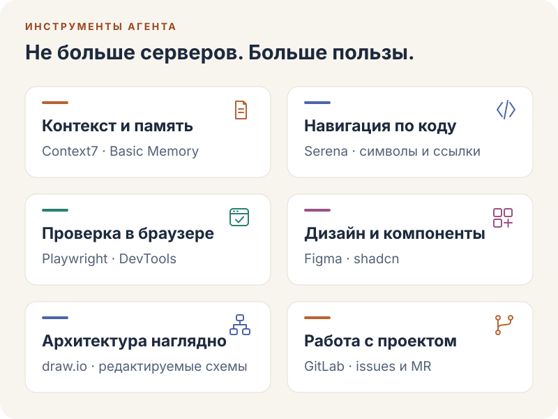
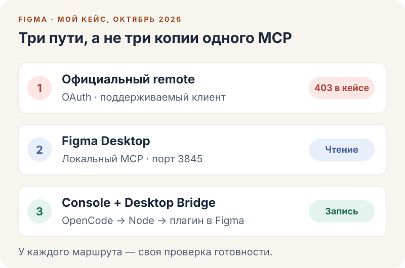
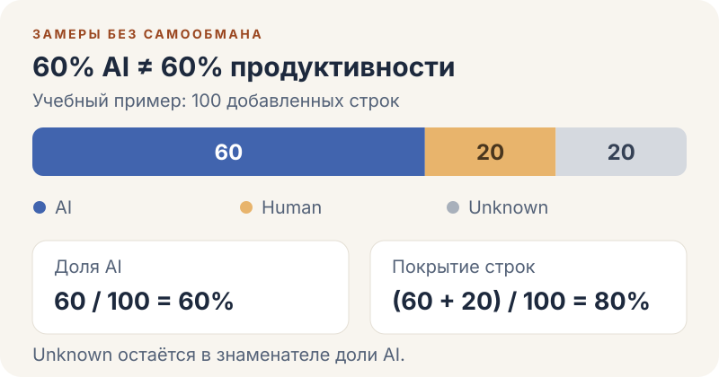

<!--
{
  "draft": false,
  "tags": ["Программирование"]
}
-->

# MCP и полезные AI-инструменты: от Figma до замеров

```blogEnginePageDate
25 октября 2026
```

Подключить агенту десяток инструментов — ещё не значит наладить работу. Нужно объяснить задачу, дать нужный доступ,
проверить результат и не перепутать красивые проценты с полезными изменениями. Здесь собрал свой набор MCP,
истории починки Serena и Figma, grill-me, OpenSpec, UX, создание роликов и замеры git-ai — с примерами подключения
и промптами для агента.

Это продолжение статьи [Vibe Coding — простыми словами](../Vibe%20Coding%20%E2%80%94%20Getting%20Started/index.html).
Читать всё подряд не обязательно: ниже можно выбрать маршрут под свою задачу.

<a id="toc"></a>

## Оглавление: выберите свою задачу

1. **Настроить рабочее место:** [какие MCP выбрать](#mcp), [код подключения](#connect),
   [промпты для настройки агентом](#agent-setup), [история починки Serena](#serena-fix).
2. **Работать с дизайном и готовыми приложениями:** [Figma и её три подключения](#figma),
   [REA для исследования поведения](#rea).
3. **Превратить идею в понятную задачу:** [grill-me](#grill-me) → [OpenSpec](#openspec) → [UX-чек-лист](#ux).
4. **Сделать ролик:** [три подхода и рабочий процесс](#video), [HyperFrames: CLI и MCP](#hyperframes),
   [другие полезные находки](#more-tools).
5. **Разобраться в замерах:** [что считает git-ai-dashboard](#metrics), [почему было 0% AI и unknown model](#git-ai-fix).
6. **Забрать самое важное:** [короткий маршрут от идеи до проверки](#checklist).

> **Если вы только начинаете:** подключите Context7 и один браузерный инструмент из первой части.
> Затем попробуйте связку grill-me → OpenSpec. Figma, REA и видео нужны не каждой задаче.

Длинные конфиги и подробности поломок спрятаны в раскрывающиеся блоки — открывайте только нужные.

---

<a id="mcp"></a>

## 1. Выбрать и подключить MCP

**Коротко:** MCP даёт агенту доступ к инструментам. Начинайте с нужной возможности, а не с установки всего списка.

<figure>
  <div class="blogImage_container"></div>
  <figcaption><em>Выбирайте возможность под задачу, а не коллекционируйте подключения.</em></figcaption>
</figure>

**MCP — стандартный способ подключить AI-приложение к данным и действиям.** Host — само приложение, например OpenCode.
Client — его компонент, который общается с конкретным сервером. Server предоставляет возможности и не обязательно
находится в интернете: это может быть локальный процесс. ([Архитектура MCP](https://modelcontextprotocol.io/docs/2026-07-28/learn/architecture))

У сервера бывают **tools** — вызываемые операции, **resources** — данные для контекста, **prompts** — готовые шаблоны
взаимодействия. Не каждый сервер реализует всё сразу.
([Понятия MCP](https://modelcontextprotocol.io/docs/2026-07-28/learn/server-concepts))

Не стоит смешивать три вещи. MCP описывает интерфейс подключения. **Skill** объясняет агенту, как выполнять работу,
обычно через `SKILL.md` и дополнительные материалы. **CLI** — программа с командами для терминала. Skill может
использовать CLI или MCP; они дополняют друг друга. ([Agent Skills](https://agentskills.io/what-are-skills))

Вот назначение всех одиннадцати подключений из моего списка. Название в настройках — метка: по одному `drawio` или
`gitlab` нельзя установить конкретный пакет и его версию. Ссылки показывают назначение и примеры реализаций.

| Группа | Метка | Для чего нужна |
|---|---|---|
| Память | `basic-memory` | Долговременные Markdown-заметки, поиск и связи. Не автоматическая память обо всех чатах. [Проект](https://github.com/basicmachines-co/basic-memory) |
| Документация | `context7` | Документация библиотек и примеры с учётом версии. [Проект](https://github.com/upstash/context7) |
| Код | `serena` | Поиск символов и ссылок, точечные изменения и рефакторинг. [Проект](https://github.com/oraios/serena) |
| Браузер | `playwright` | Пройти пользовательский сценарий: открыть страницу, заполнить форму, проверить состояние. [Пример реализации](https://github.com/microsoft/playwright-mcp) |
| Браузер | `chrome-devtools` | Разобраться в ошибке: консоль, сеть, производительность, скриншоты. [Проект](https://github.com/ChromeDevTools/chrome-devtools-mcp) |
| Схемы | `drawio` | Редактируемые диаграммы архитектуры и потоков. [Пример реализации](https://github.com/jgraph/drawio-mcp) |
| Репозиторий | `gitlab` | Проекты, issues, merge requests и данные для ревью в пределах выданных прав. [Документация](https://docs.gitlab.com/user/model_context_protocol/mcp_server/) |
| UI | `shadcn` | Поиск, просмотр и добавление компонентов из совместимых реестров. [Документация](https://ui.shadcn.com/docs/mcp) |
| Figma | `figma` | Официальный удалённый MCP: контекст дизайна и запись для поддерживаемых клиентов. В списке требует входа, ещё не подключён. [Remote](https://developers.figma.com/docs/figma-mcp-server/remote-server-installation/) |
| Figma | `figma-desktop` | Официальный сервер в Figma Desktop: контекст макета, выделение, скриншоты; без записи на холст. [Desktop](https://developers.figma.com/docs/figma-mcp-server/local-server-installation/) |
| Figma | `figma-console` | Сторонний локальный сервер и плагин-мост для создания и изменения дизайна. [Использованная версия](https://github.com/southleft/figma-console-mcp/tree/v1.40.9) |

Разделение браузеров условное: Playwright удобно использовать для сценария, DevTools — для диагностики, но возможности
пересекаются. Один проход агентом по странице не становится автоматически полноценным набором автотестов.

<a id="connect"></a>

### Код подключения: начните с двух серверов

Далее — примеры **для OpenCode V2**, а не универсальный JSON для любого клиента. Нужны Node.js LTS и npm;
для браузерной работы — браузер. Запускайте команды в корне нужного проекта:

```sh
opencode mcp add context7 --url https://mcp.context7.com/mcp
opencode mcp add playwright -- npx -y @playwright/mcp@latest
opencode mcp list
```

Без `--global` настройки относятся к проекту; этот флаг нужен только для осознанной установки во все проекты.
Тот же набор можно описать вручную в `opencode.jsonc`:

```json
{
  "$schema": "https://opencode.ai/config.json",
  "mcp": {
    "servers": {
      "context7": {
        "type": "remote",
        "url": "https://mcp.context7.com/mcp"
      },
      "playwright": {
        "type": "local",
        "command": ["npx", "-y", "@playwright/mcp@latest"]
      }
    }
  }
}
```

**Выберите CLI или ручное редактирование — выполнять оба варианта не нужно.** Если конфиг уже существует,
добавляйте записи в его `mcp.servers`, а не заменяйте весь файл. OpenCode подхватывает изменения без перезапуска.
Если сервер ожидает OAuth, откройте `/mcps` и войдите сами: запись в JSON ещё не означает успешное подключение.
([Документация V2](https://opencode.ai/v2/docs/mcp-servers))

<details>
<summary>Ещё шесть MCP: DevTools, Serena, Basic Memory, shadcn, draw.io и GitLab — готовый JSON</summary>

Выберите только нужные записи и добавьте их в существующий конфиг. Это **примеры актуальных публичных реализаций**,
а не восстановленная копия всех моих настроек со скриншота.

```json
{
  "$schema": "https://opencode.ai/config.json",
  "mcp": {
    "servers": {
      "chrome-devtools": {
        "type": "local",
        "command": ["npx", "-y", "chrome-devtools-mcp@latest", "--no-usage-statistics", "--no-performance-crux"]
      },
      "serena": {
        "type": "local",
        "command": ["serena", "start-mcp-server", "--context", "ide", "--project", "."],
        "cwd": ".",
        "timeout": { "startup": 60000 }
      },
      "basic-memory": {
        "type": "local",
        "command": ["uvx", "basic-memory", "mcp"]
      },
      "shadcn": {
        "type": "local",
        "command": ["npx", "-y", "shadcn@latest", "mcp"]
      },
      "drawio": {
        "type": "local",
        "command": ["npx", "-y", "@drawio/mcp"]
      },
      "gitlab": {
        "type": "remote",
        "url": "https://gitlab.com/api/v4/mcp"
      }
    }
  }
}
```

Что подготовить:

- **DevTools:** установленный Chrome. Два флага отключают статистику использования сервера и запросы к CrUX,
  но не делают весь браузерный трафик локальным. [README](https://github.com/ChromeDevTools/chrome-devtools-mcp).
- **Serena:** установленный `uv`, затем `uv tool install -p 3.13 serena-agent` и `serena init`.
  Пример использует установленный CLI; если OpenCode его не находит, укажите абсолютный путь к исполняемому файлу.
  Зависимости language server зависят от языка проекта.
  [Установка](https://oraios.github.io/serena/02-usage/010_installation.html),
  [контекст ide](https://oraios.github.io/serena/02-usage/030_clients.html#terminal-based-clients).
- **Basic Memory:** `uv` и Python 3.12+. До первой записи выберите проект базы знаний и место хранения заметок.
  [Локальный quickstart](https://docs.basicmemory.com/raw/start-here/quickstart-local.md).
- **shadcn:** для добавления компонентов нужен совместимый проект и его `components.json`.
  Само подключение MCP не превращает обычный блог в React-приложение. [Документация](https://ui.shadcn.com/docs/mcp).
- **draw.io:** здесь выбран локальный Tool Server `@drawio/mcp`, открывающий редактор;
  это не облачный MCP App Server. [Варианты подключения](https://github.com/jgraph/drawio-mcp).
- **GitLab:** здесь показан официальный сервер GitLab.com с OAuth. Для своего инстанса замените домен;
  доступ к MCP должен быть разрешён группой или администратором. Legacy PAT со scope `api` не заменяет
  OAuth-токен с `mcp` scope. [Требования и авторизация](https://docs.gitlab.com/user/model_context_protocol/mcp_server/).

`@latest` и неприкреплённые версии удобны для первого знакомства, но не фиксируют состав окружения.
После проверки закрепите версии там, где это поддерживается, и обновляйте их осознанно.
На Windows при проблемах поиска `npx` укажите полный путь к подходящему исполняемому файлу; не отключайте
политику безопасности PowerShell ради одной команды.

</details>

<a id="agent-setup"></a>

### Подключение через агента: промпты вместо ручного JSON

Это **примеры запросов**, не обещание автоматической установки без разрешений. Агент может подготовить конфиг
и диагностику; вход в аккаунт и решения о правах остаются за вами.

**Для начала — документация и браузер:**

```text
Настрой Context7 и Playwright MCP для этого проекта в OpenCode V2.
Используй официальные https://mcp.context7.com/mcp и microsoft/playwright-mcp.
Прочитай актуальную V2-документацию и существующий конфиг. Другие серверы,
провайдеры и permissions сохрани. Не меняй глобальные настройки.
Сначала покажи план, diff и недостающие зависимости; дождись подтверждения.
Затем добавь подключения, проверь opencode mcp list и доступность инструментов.
Попроси Context7 найти документацию зависимости из package.json,
а Playwright — открыть https://example.com в новой вкладке и прочитать заголовок.
OAuth выполняю я через /mcps. Не называй сервер подключённым до проверки.
Промежуточные файлы сохраняй в .temp/, секреты не печатай и не коммить.
```

<details>
<summary>Промпт: добавить кодовую навигацию, память, UI, схемы и диагностику</summary>

Из строки с серверами удалите лишнее. Установка Serena через `uv tool install` затрагивает пользовательское
окружение, поэтому её нужно согласовать отдельно от редактирования проектного конфига.

```text
Добавь к проектному OpenCode V2 выбранные MCP: Serena, Basic Memory,
shadcn, draw.io Tool Server и Chrome DevTools. Найди официальные инструкции
oraios/serena, basicmachines-co/basic-memory, shadcn, jgraph/drawio-mcp
и ChromeDevTools/chrome-devtools-mcp; не выбирай одноимённые пакеты наугад.
Сохрани существующие настройки. Покажи план и diff, дождись подтверждения.
Установку uv/Python/пакетов вне проекта согласуй отдельно.
Serena привяжи к текущему workspace; прочитай её initial instructions.
Проверь поиск существующего символа, список проектов памяти и список UI-компонентов.
Через draw.io создай тестовую схему без рабочих данных; через DevTools
открой example.com в новой вкладке. Ничего не записывай в память,
не добавляй компоненты в приложение и не рефактори код без отдельного запроса.
Результаты проверок и временные файлы положи в .temp/.
```

</details>

<details>
<summary>Промпт: подключить GitLab без передачи токена в чат</summary>

```text
Подключи официальный GitLab MCP в OpenCode V2 только для этого проекта.
Сначала уточни адрес инстанса; проверь его документацию и разрешён ли MCP.
Используй endpoint /api/v4/mcp и штатный OAuth, не проси прислать токен в чат.
Покажи diff существующего конфига и дождись подтверждения.
После сохранения предложи мне войти через /mcps.
Затем проверь connected и прочитай метаданные указанного мной проекта.
Не создавай issues, комментарии и MR, не запускай pipelines.
Если получен 403, сообщи конкретный этап сбоя; не расширяй права наугад.
```

</details>

Критерий готовности одинаковый: **сервер виден → авторизация завершена, если нужна → одна настоящая операция успешна**.
Для [Figma ниже есть отдельный конфиг и промпт](#figma-setup): одного статуса Node-процесса там недостаточно.

<a id="serena-fix"></a>

<details>
<summary>Личный кейс: как я сломал и восстановил подключение Serena</summary>

Когда разбирался с Figma на Windows, принял несколько MCP-процессов за лишние и остановил их. Вместе с ними исчезли
инструменты Serena и других серверов. Вернул их пересозданием подключений в OpenCode: в том эпизоде изменение записи
сервера, включая startup timeout, заставило соединение создаться заново.

Это **восстановление MCP-подключения, а не подтверждённый ремонт language server**. Отдельной истории ошибки LSP
запись не подтверждает. Практический вывод: сначала выяснить, какую сессию обслуживает процесс, затем проверить
подключение через `opencode mcp list` или `/mcps`. Большое число процессов само по себе не доказывает утечку.
([Управление MCP в OpenCode V2](https://opencode.ai/v2/docs/mcp-servers))

</details>

MCP также не является песочницей. Локальный сервер получает права запускающего пользователя: стоит проверять издателя,
фиксировать версии, ограничивать доступ и не класть секреты в репозиторий. Успешный вызов инструмента нужно подтверждать
изменённым объектом, diff или тестом. ([Безопасность локальных серверов](https://modelcontextprotocol.io/docs/2026-07-28/tutorials/security/local-server-security))

[↑ К оглавлению](#toc)

---

<a id="design"></a>

## 2. Дизайн и исследование приложений

**Когда читать:** нужно редактировать Figma или понять поведение существующего приложения.
Это разные задачи: Figma даёт доступ к макету, REA — к средствам исследования программы.

<a id="figma"></a>

### Figma: почему понадобилось три подключения

<figure>
  <div class="blogImage_container"></div>
  <figcaption><em>403 — результат моего случая, а не вечное ограничение для всех клиентов.</em></figcaption>
</figure>

В моём случае **12 октября 2026 года, Windows и OpenCode 2.0.26** официальный remote упёрся в HTTP 403 при регистрации
OAuth-клиента OpenCode. Это не просто забытый вход: документация Figma ограничивает подключение поддерживаемыми
клиентами. Исторический сбой не означает, что совместимость останется такой навсегда.
([Официальное подключение](https://developers.figma.com/docs/figma-mcp-server/remote-server-installation/))

Официальный desktop endpoint `http://127.0.0.1:3845/mcp` давал читать макет, но не писать на canvas. Для записи
подключил **`southleft/figma-console-mcp@1.40.9` и Figma Desktop Bridge**. Это другой маршрут:
OpenCode → локальный Node-сервер → WebSocket → плагин в открытом Figma-файле. PAT используется для REST-функций,
а действия на холсте выполняются через плагин; это не обход OAuth официального remote.
([README 1.40.9](https://github.com/southleft/figma-console-mcp/blob/v1.40.9/README.md))

<a id="figma-setup"></a>

<details>
<summary>Подключить Figma: установка, JSON для трёх маршрутов и проверка bridge</summary>

Точная первоначальная install-команда не сохранилась. Подтверждены локальный npm-пакет и итоговый запуск через
`node` файла `~/.figma-console-mcp/server/node_modules/figma-console-mcp/dist/local.js`, **не через `npx`**:
в этом Windows-окружении возникали осиротевшие процессы. Это наблюдение конкретного случая, не общий запрет на `npx`.

Воспроизводимый npm-вариант под такую схему, а не запись моей первоначальной команды, для PowerShell:

```powershell
npm install --prefix "$HOME/.figma-console-mcp/server" figma-console-mcp@1.40.9
```

README описывает запуск пакета через `npx` и альтернативную сборку из Git; здесь пакет закреплён локально ради прямого
Node-запуска. Нужны Node.js 18+ и Figma Desktop. В конфиге **OpenCode V2** ниже замените placeholder
абсолютным путём к установленному `local.js`, а PAT заранее передайте через окружение процесса OpenCode.
Не вставляйте значение токена в JSON. Официальный remote оставлен с `disabled: true`: включайте его только после
проверки поддержки клиента и готовности пройти OAuth; для console он не требуется.
([Настройка сервера](https://github.com/southleft/figma-console-mcp/blob/v1.40.9/docs/setup.md),
[формат OpenCode V2](https://opencode.ai/v2/docs/mcp-servers))

```json
{
  "$schema": "https://opencode.ai/config.json",
  "mcp": {
    "servers": {
      "figma": {
        "type": "remote",
        "url": "https://mcp.figma.com/mcp",
        "disabled": true
      },
      "figma-desktop": {
        "type": "remote",
        "url": "http://127.0.0.1:3845/mcp"
      },
      "figma-console": {
        "type": "local",
        "command": ["node", "<абсолютный путь к local.js>"],
        "environment": {
          "FIGMA_ACCESS_TOKEN": "{env:FIGMA_ACCESS_TOKEN}"
        }
      }
    }
  }
}
```

Для официального `figma-desktop` отдельно включите **Dev Mode → Enable desktop MCP server** в Figma Desktop.
Доступность зависит от плана и seat. Для стороннего console после запуска сервера открыть нужный файл:
**Plugins → Development → Import plugin from manifest…**,
выбрать стабильный `~/.figma-console-mcp/plugin/manifest.json`, затем запустить **Figma Desktop Bridge** в этом файле.
Официальный desktop MCP на порту 3845 для работы этого моста не требуется.

Дальше проверить `figma_get_status({ probe: true })`: важно получить **`pluginConnected: true`** именно от сервера,
которым пользуется текущий агент. После изменения через `figma_execute` — сделать `figma_take_screenshot` и проверить
результат. Официальный **`use_figma` и сторонний `figma_execute` — разные API**, не взаимозаменяемые названия.
([Инструменты Figma](https://developers.figma.com/docs/figma-mcp-server/tools-and-prompts/))

При `no plugin connected` или бесконечном `Loading Figma Desktop Bridge…` нужно сверять текущий инстанс,
`transport.websocket.port`, открытый документ и импортированный manifest. При обновлениях учитывать кэш плагина.
Нельзя объяснять всё правилом «bridge видит только первый порт»: версия 1.40.9 поддерживает несколько серверов.
И точно не стоит лечить это массовой остановкой всех Node-процессов.
([Устройство bridge](https://github.com/southleft/figma-console-mcp/blob/v1.40.9/docs/setup.md))

</details>

<details>
<summary>Промпт: попросить агента настроить запись в Figma</summary>

```text
Мне нужна запись на холст Figma из OpenCode V2, а не только чтение макета.
Сначала проверь актуальные официальные варианты и поддержку моего клиента.
Если remote недоступен, предложи southleft/figma-console-mcp с Desktop Bridge;
воспроизводи описанный кейс на 1.40.9 только если я выберу эту версию.
Объясни права стороннего плагина, предложи план и diff; дождись подтверждения.
Установку за пределами проекта согласуй отдельно. Сохрани остальные подключения.
Токен я передам через FIGMA_ACCESS_TOKEN; не проси его в чате и не сохраняй в git.
Для локального запуска найди абсолютный путь к dist/local.js и используй node.
Дай мне шаги импорта manifest и запуска bridge в выбранном Figma-файле.
Проверь статус именно текущего инстанса: pluginConnected должен быть true.
После моего согласия создай тестовый фрейм, сделай скриншот и проверь результат.
Не чисти чужие процессы и не меняй существующие экраны ради теста.
```

</details>

**Проверка готовности:** для чтения — полученный контекст макета; для записи — подключённый bridge
и согласованный контрольный объект на холсте, а не просто зелёный процесс.

<a id="rea"></a>

### REA: сначала исследовать поведение, потом писать

**[REA — Reverse Engineer Anything](https://github.com/morluto/rea)** — MCP для исследования приложений: декомпиляторы,
наблюдения во время выполнения и агентный цикл. Вместо попытки угадать устройство программы агент получает сведения
из специализированных инструментов, проверяет гипотезу действием и уточняет вывод.

В [ролике Swag](https://www.youtube.com/watch?v=5AhuSmReTOk) автор рассказывает, как исследовал Screen Brush и написал
альтернативу [ScreenInk](https://github.com/volyx/ScreenInk) для рисования поверх экрана. Это **заявление автора
о своём опыте**, а не мой эксперимент или обещание повторить результат с любым приложением.

Полезные авторские главы: [00:20 — что такое REA](https://www.youtube.com/watch?v=5AhuSmReTOk&t=20s),
[02:09 — демо Screen Ink](https://www.youtube.com/watch?v=5AhuSmReTOk&t=129s),
[03:15 — устройство REA](https://www.youtube.com/watch?v=5AhuSmReTOk&t=195s).

Практическая задача здесь — разобраться в конкретном поведении: какие есть состояния, что меняется после действия,
чем подтверждается правило. Это полезнее установки «восстанови весь проект». Декомпиляция не гарантирует получение
исходников один в один.

Исследовать нужно ПО, которое разрешено анализировать, с учётом лицензий и прав. REA не выдаёт лицензии на чужие
декомпиляторы и не превращает копирование платного софта в универсально разрешённую операцию. Локальный анализ также
не означает, что извлечённые данные не попадут подключённой облачной модели.
([Описание и ограничения проекта](https://github.com/morluto/rea#disclaimer))

[↑ К оглавлению](#toc)

---

<a id="planning"></a>

## 3. От идеи до проверяемого интерфейса

**Когда читать:** агент умеет вызывать инструменты, но задача пока звучит как «сделай удобно».
Здесь три шага: обсудить решения, записать требования, проверить UX.

<a id="grill-me"></a>

### grill-me: вскрыть допущения до написания кода

**[grill-me](https://github.com/mattpocock/skills/blob/main/skills/productivity/grill-me/SKILL.md) от Matt Pocock** —
skill для уточнения плана, не MCP и не генератор кода. [README](https://github.com/mattpocock/skills#readme)
относит его к общим, не кодовым сценариям; здесь он полезен для проработки продуктовой идеи перед разработкой.

Агент строит **дерево решений**: ответ о пользователе определяет следующие вопросы о сценарии. В раунде задаёт вопросы,
предпосылки которых уже согласованы, предлагает рекомендации и ждёт ответов. Так последовательно вскрываются допущения,
а не выдаётся анкета на пятьдесят пунктов. **Факты о проекте агент проверяет сам; продуктовые решения принимает владелец**.
Реализация начинается только после подтверждения общего понимания.
([Механика интервью](https://github.com/mattpocock/skills/blob/main/skills/productivity/grilling/SKILL.md))

В проверенной версии `grill-me` — пользовательская точка входа: она вызывает `grilling`, поэтому хосту должны быть
доступны оба skill.

<details>
<summary>Установить grill-me и забрать пример промпта</summary>

Точные команды из карточек skills.sh; вторая — для зависимого `grilling`, если он ещё недоступен хосту:

```sh
npx skills add https://github.com/mattpocock/skills --skill grill-me
npx skills add https://github.com/mattpocock/skills --skill grilling
```

Это рецепт, не выполненная здесь установка. Вызов через меню skills или `/grill-me` зависит от host:
одинаковая slash-команда во всех клиентах не гарантируется.
([grill-me](https://skills.sh/mattpocock/skills/grill-me), [grilling](https://skills.sh/mattpocock/skills/grilling))

Наш учебный запрос, не запись проведённого интервью:

```text
Хочу в git-ai-dashboard фильтр по периоду. Примени grill-me,
но пока не пиши код. Уточни: зачем фильтр и кто им пользуется,
что входит в выборку, как показывать неполные данные и ошибки stats,
по каким критериям примем результат. Устройство проекта исследуй сам.
Спрашивай раундами с рекомендациями; дождись моих решений
и подтверждения общего понимания.
```

</details>

Согласованные ответы затем передаются в OpenSpec proposal/specs. Это наша связка инструментов, не автоматическая
интеграция. Интервью уменьшает число молчаливых допущений, но не устраняет все ошибки и не заменяет проверки.

<a id="openspec"></a>

### OpenSpec: сохранить договорённости в проекте

Когда инструменты подключены, остаётся вопрос: что именно они должны сделать? **[OpenSpec](https://github.com/Fission-AI/OpenSpec/blob/v1.15.0/README.md)**
выносит требования из чата в версионируемые файлы. Это CLI и рабочие инструкции для агента, **не MCP-сервер**.
На дату проверки, 25 октября 2026 года, актуальный стабильный релиз —
**[1.15.0](https://github.com/Fission-AI/OpenSpec/releases/tag/v1.15.0)**.

Для npm-варианта нужен Node.js **>=20.19.0**. Установка и инициализация в терминале:

```sh
npm install -g @fission-ai/openspec@1.15.0
openspec init
```

`init` предлагает интеграции с агентами и создаёт структуру проекта. Основной современный цикл:
**`/opsx:propose` → review человеком → `/opsx:apply` → тесты и review → `/opsx:archive`**.
Это команды **в чате**, не shell; конкретное написание зависит от клиента и выводится при настройке.
([Quickstart](https://openspec.dev/docs/quickstart),
[команды 1.15.0](https://github.com/Fission-AI/OpenSpec/blob/v1.15.0/docs/commands.md))

<details>
<summary>Пример: поставить через OpenSpec задачу на кнопку копирования кода</summary>

Небольшое изменение для существующего блога:

```text
/opsx:propose add-code-copy

Добавь кнопку «Скопировать» у блоков кода. Копируется только код,
без подписи языка и текста кнопки. При отказе копирования показываем
ошибку, а не успех. Выделение текста не ломаем. Новых зависимостей
без согласования не добавляем. Сейчас подготовь только план.
```

</details>

`proposal.md` объясняет зачем и что меняем; `specs` описывают поведение; `design.md` — технические решения,
когда они нужны; `tasks.md` — задачи. Важное различие: **`openspec/specs/` — текущие согласованные требования**,
а `openspec/changes/add-code-copy/specs/` — изменения требований, не вторая полная копия документации.
([Структура](https://openspec.dev/docs/setup))

Человек читает план и уточняет сценарии: что произойдёт при запрещённом доступе к буферу, повторном клике, работе
с клавиатуры? Только затем отдельным запросом запускается `/opsx:apply add-code-copy`. После реализации — реальные
проверки и ревью, затем `/opsx:archive add-code-copy` с обновлением основных specs.

`openspec validate add-code-copy --strict` проверяет **форму артефактов, не правильность кнопки**.
Галочки в задачах не заменяют запуск приложения и проверку отказного сценария.
([CLI validate](https://openspec.dev/docs/cli))

<a id="ux"></a>

### UX: работающая кнопка ещё не означает удобный интерфейс

#### Что удалось извлечь из доклада

В [докладе Михаила Проскурина «Минимально жизнеспособный дизайн: UX для каждого»](https://www.youtube.com/watch?v=Y6q7z3rbbgs)
эвристики Нильсена предлагаются как практическая проверка для фронтендера.

В поисковых выдержках расшифровки блока **19:23–19:44 и его продолжения** есть вопросы: сохранятся ли данные при
переходе на другую страницу, можно ли восстановить удалённое, повторить действие и вернуться назад. Это смысловой
пересказ текстового фрагмента, не аудиосверенная цитата.
([Начало блока](https://www.youtube.com/watch?v=Y6q7z3rbbgs&t=1163s))

Полный авторский чек-лист, Markdown-файл и слайды недоступны в собранных материалах. Поэтому ниже **это моя адаптация
по NN/g, а не полный список вопросов Проскурина**. Основа — десять эвристик Jakob Nielsen, общие принципы,
а не гарантия хорошего UX. ([Официальный NN/g](https://www.nngroup.com/articles/ten-usability-heuristics/))

#### Рабочая адаптация для проверки интерфейса

| Принцип | Практические вопросы |
|---|---|
| Видимость состояния | Видно ли, что действие принято и выполняется? Понятен ли результат? |
| Соответствие реальному миру | Понятны ли слова пользователю без внутреннего жаргона? Соответствует ли порядок информации его задаче? |
| Контроль и свобода | Можно ли выйти из сценария и отменить ошибочное действие? Сохраняется ли нужный ввод? |
| Согласованность и стандарты | Одинаково ли работают одинаково названные действия? Соблюдены ли привычные соглашения платформы? |
| Предотвращение ошибок | Можно ли убрать условия ошибки заранее? Есть ли уместная защита опасного действия? |
| Узнавание вместо запоминания | Видны ли варианты в момент выбора? Не приходится ли помнить данные с предыдущего экрана? |
| Гибкость и эффективность | Есть ли понятный путь для новичка и быстрый для опытного? Удобны ли повторяющиеся операции? |
| Эстетика и минимализм | Что отвлекает от главной задачи? Нужна ли вся показанная информация именно сейчас? |
| Помощь при ошибках | Объясняет ли сообщение конкретную проблему человеческим языком? Предлагает ли выполнимое исправление? |
| Помощь и документация | Можно ли быстро найти подсказку по текущей задаче? Есть ли конкретные шаги? |

Такой список полезно дать агенту вместе со сценарием, а не просить «сделай красиво». Браузерный MCP поможет пройти
экраны; человек проверит, действительно ли поведение понятно и безопасно.

[↑ К оглавлению](#toc)

---

<a id="video"></a>

## 4. Видео и другие полезные находки

**Когда читать:** нужен ролик, анимация или заготовки для интерфейса. Начните с выбора результата:
кодовая motion-графика, монтаж существующей съёмки и генерация видео — не одно и то же.

### Что взять из трёх роликов

| Что хотите получить | С чего начать | На что обратить внимание |
|---|---|---|
| Кодовую motion-графику | [Визави: vizavi_motion](https://www.youtube.com/watch?v=L4MM8BQ9dTM) | Стиль, раскадровка, референсы и проверка экспорта |
| Промо, анимацию или короткий формат | [ИИ МАСТОДОНТ: HyperFrames и Claude Code](https://www.youtube.com/watch?v=yEpN_s9UkAE) | В ролике семь разных форматов, а не один pipeline |
| Монтаж исходной съёмки и motion | [Try CGI: монтаж и After Effects](https://www.youtube.com/watch?v=umKxRXX4-Mg) | Первая версия, адресные правки, проверка движения и звука |

<details>
<summary>Что подтверждено материалами трёх роликов и где взять скилл</summary>

**[Визави](https://www.youtube.com/watch?v=L4MM8BQ9dTM)** — `vizavi_motion`, выбор стиля и глубины сцены, референсы,
изображения и 3D-модели. На [странице материалов](https://vizavi.academy/lesson-motion/) доступен скилл;
в проверенном архиве **v1.6.1** есть инструкции по раскадровке, короткой пробе, просмотру и экспорту.
Это текущие материалы, не доказательство версии скилла в момент записи.
([ZIP](https://vizavi.academy/lesson-motion/downloads/vizavi_motion-v1.6.1.zip))

Архив скилла импортируется в Claude через **Customize → Skills → + → Upload a skill**. Это подключение инструкции:
оно само по себе не создаёт готовый MP4.

**[ИИ МАСТОДОНТ](https://www.youtube.com/watch?v=yEpN_s9UkAE)** перечисляет семь форматов: мем, motion-ролик,
мультфильм, промо запуска, вертикальный шортс, монтаж говорящей головы и музыкальный клип. HyperFrames явно привязан
к промо запуска в [главе 05:07](https://www.youtube.com/watch?v=yEpN_s9UkAE&t=307s), но не доказан для всех семи примеров.
Монтаж снятого человека — не то же самое, что генерация человека по тексту.

**[Try CGI](https://www.youtube.com/watch?v=umKxRXX4-Mg)** — монтаж, 2D motion, заявленный 3D tracking и создание проекта
After Effects. Полезна последовательность авторских глав:
[первая версия, 21:40](https://www.youtube.com/watch?v=umKxRXX4-Mg&t=1300s) →
[правки, 22:30](https://www.youtube.com/watch?v=umKxRXX4-Mg&t=1350s).
Точный движок монтажа и API управления AE не установлены; приписывать этому примеру конкретный MCP или renderer нельзя.

</details>

### Общий рабочий процесс

Это моя сборка процесса по описаниям и материалам, не последовательность команд из видео:

1. **Бриф.** Аудитория, сюжет, длительность, размер кадра, стиль, обязательные надписи, звук и конечные файлы.
2. **Раскадровка.** Сцены, действие, переходы и ритм. Проверить, что агент действительно получил референс, а не только URL.
3. **Ассеты и лицензии.** Подготовить реальные файлы, проверить форматы, авторство и условия использования музыки, картинок, моделей.
4. **Короткая проба.** Сначала самый рискованный эффект или переход, потом весь ролик.
5. **Анимация или монтаж.** Для кодовой графики — управляемый таймлайн; для исходной съёмки — отдельно поставленные монтажные задачи.
6. **Просмотр и правки.** Смотреть движение и слушать звук. Замечание: интервал → дефект → нужное изменение → повторная проверка.
7. **Экспорт.** Проверить именно финальный MP4: длительность, параметры, начало, конец, переходы и синхронизацию звука, если он есть. Сохранить исходники.

<details>
<summary>Промпт: заказать двенадцатисекундный ролик про MCP</summary>

Мой пример запроса, не цитата из роликов:

```text
Сделай объяснение MCP на 12 секунд: 1920×1080, 30 fps, MP4 H.264,
без звука. Стиль SaaS/UI, 2D, тёмный фон, крупные русские подписи.
Три сцены по четыре секунды: запрос → инструмент → проверка результата.
Используй только собственные схемы. Сначала предложи раскадровку
и двухсекундную пробу перехода. После согласования собери ролик.
Проверь экспорт и отдай MP4 вместе с редактируемыми исходниками.
```

</details>

<a id="hyperframes"></a>

### HyperFrames: локальный CLI отдельно от облачного MCP

Для локального кодового видео [HyperFrames](https://github.com/heygen-com/hyperframes) превращает HTML/CSS и медиа
в MP4. **Локальный путь — исходники и собственный рендер; облачный MCP — аккаунт HeyGen, авторизация и внешний сервис.**

<details>
<summary>Локальный путь: CLI, skills и экспорт</summary>

Нужны **Node.js 22+ и FFmpeg**. Минимальный путь из README:

```sh
npx hyperframes init my-video
cd my-video
npx hyperframes preview
npx hyperframes render
```

Между созданием проекта и рендером нужно подготовить композицию и проверить preview. Эти команды сверены по
документации, а не исполнены здесь как видеопроизводственный эксперимент. `npx hyperframes skills update` — отдельная
установка/обновление инструкций агента, **не команда рендера**. ([Quickstart](https://hyperframes.heygen.com/quickstart))

</details>

Есть и другой маршрут: **hosted HyperFrames MCP в beta через HeyGen**. Он требует авторизации, отправляет материалы
внешнему сервису и имеет собственные лимиты. Это не локальный CLI с другим названием и не подтверждённая конфигурация
из перечисленных видео. Перед подключением надо решить, какие данные можно передавать.
([MCP guide](https://hyperframes.heygen.com/guides/mcp.md))

<details>
<summary>Облачный путь: код подключения и промпт агенту</summary>

Добавьте в `mcp.servers` своего OpenCode V2; локальный HyperFrames CLI для этого маршрута не требуется:

```json
{
  "$schema": "https://opencode.ai/config.json",
  "mcp": {
    "servers": {
      "hyperframes": {
        "type": "remote",
        "url": "https://mcp.heygen.com/mcp/hyperframes/"
      }
    }
  }
}
```

Или поручите настройку агенту:

```text
Подключи hosted HyperFrames MCP к проектному OpenCode V2 по официальной
инструкции HeyGen: https://hyperframes.heygen.com/guides/mcp.md.
Не устанавливай локальный CLI вместо облачного connector.
Покажи diff существующего конфига и дождись моего подтверждения;
после сохранения предложи мне пройти авторизацию через /mcps.
Проверь подключение и каталог инструментов. Не отправляй рабочие материалы
и не запускай рендер до моего согласия на передачу данных и возможные затраты.
```

</details>

<a id="more-tools"></a>

### Что ещё взять из подборки инструментов

Из [подборки «Тут про планирование»](https://www.youtube.com/watch?v=le-WtDYAiSI) полезно выделить три направления:
[21st.dev](https://21st.dev) — заготовки интерфейсов, [HyperFrames](https://github.com/heygen-com/hyperframes) —
программное видео, [REA](https://github.com/morluto/rea) — исследование приложений.

Первые можно использовать как старт UI, но красивая заготовка не гарантирует доступность и хороший UX.
Два остальных уже разобраны выше: выбирать стоит по задаче, а не устанавливать всю подборку сразу. Например,
взять компонент, описать его состояния в требованиях и пройти отказные сценарии из UX-проверки.

[↑ К оглавлению](#toc)

---

<a id="metrics"></a>

## 5. Замеры: что считает git-ai-dashboard

**Коротко:** происхождение добавленных строк — не продуктивность разработчика.

<figure>
  <div class="blogImage_container"></div>
  <figcaption><em>Учебная арифметика, не рабочая статистика проекта.</em></figcaption>
</figure>

В замерах важно разделять три слоя. **Официальный [git-ai](https://usegitai.com/docs/get-started/how-git-ai-works)**
получает события агента, делает checkpoints и сохраняет атрибуцию коммитов в `refs/notes/ai`. Это **не AI-детектор**,
угадывающий происхождение по стилю кода.

**Локальный адаптер OpenCode V2** доставляет события в git-ai. **`git-ai-dashboard`** — статические HTML и CSV поверх истории,
notes и `git ai stats`; собственного распознавания AI-кода у него нет.

### Что означает доля AI

В dashboard **AI** — строки с AI-атрибуцией, **human** — с известной человеческой атрибуцией,
**unknown** — без установленного происхождения. Нет note — **не значит «написал человек»**: причиной бывает старая
история, недоставленные notes или сломанная интеграция. При отсутствии note или ошибке stats dashboard относит
добавления в unknown. ([Поля commit stats](https://usegitai.com/docs/get-started/commit-stats))

Основная доля считается так: **`SUM(AI additions) / SUM(additions)` по выбранной non-merge истории**.
Это не среднее процентов отдельных коммитов и не доля AI в текущем дереве. Переписанная в нескольких коммитах строка
может участвовать в сумме несколько раз.

Учебный пример, не рабочая статистика: **60 AI + 20 human + 20 unknown = 100 добавленных строк**.
Доля AI — **60%**, покрытие строк атрибуцией — **80%**. Делить только на известные 80 строк и объявлять 75%
основной долей было бы сменой знаменателя.

Отдельно считается **coverage по коммитам: коммиты с note / все выбранные non-merge-коммиты**.
Это не покрытие строк: даже при наличии note часть строк может остаться unknown. Для сравнения замеров нужны одинаковые
границы истории, правила исключения файлов и доступные notes.

Ещё ловушка — `ai_accepted`. В текущем описании git-ai это AI-строки, принятые в коммит без ручной правки;
поле указано как равное `ai_additions`. Простое суммирование commit stats **не измеряет выживание строк после последующих изменений**.
Называть это durability или «осталось в коде через месяц» нельзя.
([Определение полей](https://usegitai.com/docs/get-started/commit-stats))

<a id="git-ai-fix"></a>

<details>
<summary>История починки: почему сначала получалось 0% AI, а затем unknown model</summary>

Исторический локальный случай: **git-ai 1.7.5, OpenCode 2.0.27, Windows**. Плагин с V1-entrypoint — функцией,
возвращающей hooks, — не загружался в V2. Не было hooks, значит, не было checkpoints. Нулевой процент говорил
о неисправном сборе, а не об отсутствии AI-правок.

В локальном patch entrypoint перенесён на definition с `id` и `setup`, а обработчики зарегистрированы через
`ctx.tool.hook("execute.before")` и `ctx.tool.hook("execute.after")`. События переводятся в ожидаемый git-ai формат
и вызывают checkpoint. ([Миграция плагинов V2](https://opencode.ai/v2/docs/build/plugins/migrate-v1))

Следующей проблемой стала **unknown model**: поиск данных шёл по неподходящему Windows-пути и ожидал legacy-схему БД.
Локальное решение — получить модель через session API, создать отдельную маленькую SQLite bridge-БД с совместимой
схемой и передать её каталог через `GIT_AI_OPENCODE_STORAGE_PATH`. **Оригинальную БД OpenCode не мигрировали**.
Публичный [issue о Windows lookup](https://github.com/git-ai-project/git-ai/issues/2119) описывает проблему пути;
это не подтверждение всего локального решения.

Неизвестная модель и unknown-происхождение строк — разные вещи: AI-атрибуция может работать, даже когда имя модели
не определилось.

Историческая проверка включала `git ai status --json` с `is_human: false` и заполненной моделью, затем blame и stats.
Это зафиксированный локальный результат, **не свежий end-to-end прогон и не универсальная инструкция**.
Patch не является официальным релизом. `install-hooks` или обновление могут его перезаписать; после обновления нужно
повторить всю цепочку от контрольной правки агентом до атрибуции коммита, а не только сравнить файлы плагина.

</details>

Эти проценты не показывают ускорение и не подходят для ранжирования сотрудников. Постановка задачи, архитектура,
ревью и отладка не превращаются в human additions автоматически. Для продуктивности нужны отдельные данные
о времени, сопоставимых задачах, качестве и переделках.

[↑ К оглавлению](#toc)

---

<a id="checklist"></a>

## 6. Короткий маршрут на каждый день

Полный цикл теперь выглядит так: **grill-me → согласованные решения → OpenSpec proposal/specs → apply → UX/тесты
→ замеры**. На каждом переходе нужен понятный результат, а не просто ещё один вызванный skill.

1. Выберите минимальный набор MCP и проверьте по одной реальной операции каждого.
2. Обсудите неизвестные решения через grill-me, а не молча отдавайте их агенту.
3. Сохраните требования в OpenSpec; только после согласования переходите к реализации.
4. Для интерфейса пройдите UX-сценарии, для ролика просмотрите именно экспорт, для Figma проверьте холст.
5. Перед выводами о доле AI проверьте checkpoints, модель и полноту notes.

**У каждого инструмента должен быть критерий, что он действительно сработал.** Подключение, авторизация,
плагин, реализация и сбор метрик — разные уровни; отдельно проверенный шаг проще починить.

<details>
<summary>О версиях, источниках и границах проверки</summary>

Срез статьи — 25 октября 2026 года. По видео использованы авторские описания, главы и доступные материалы,
а не полные стенограммы. Таймкоды глав помогают найти нужный блок, но не подтверждают каждую реплику.
Учебные промпты написаны для статьи; команды подключения сверены с документацией, но не выдаются за мои
исторические shell-команды или новый end-to-end прогон всех серверов. Ограничения UX-чек-листа отмечены отдельно.

</details>
