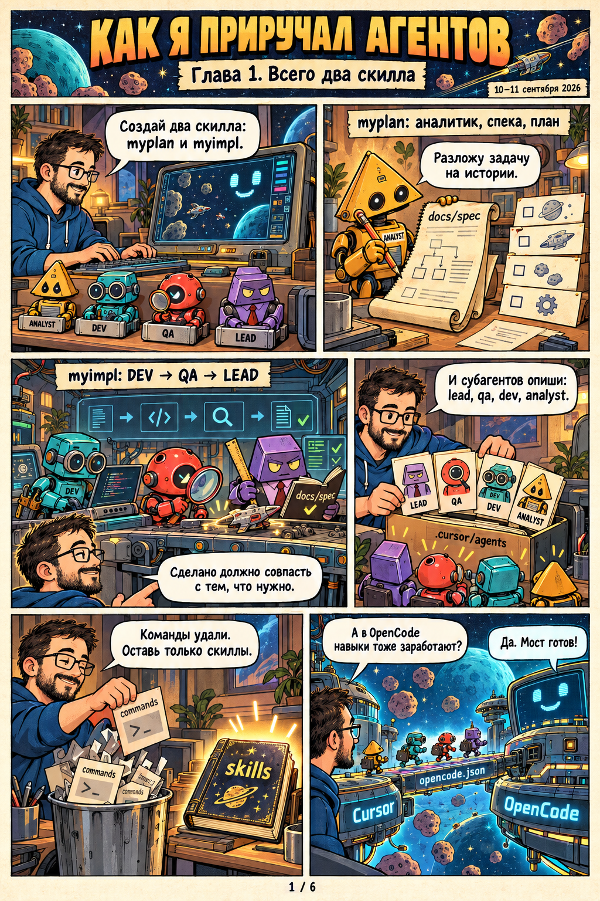
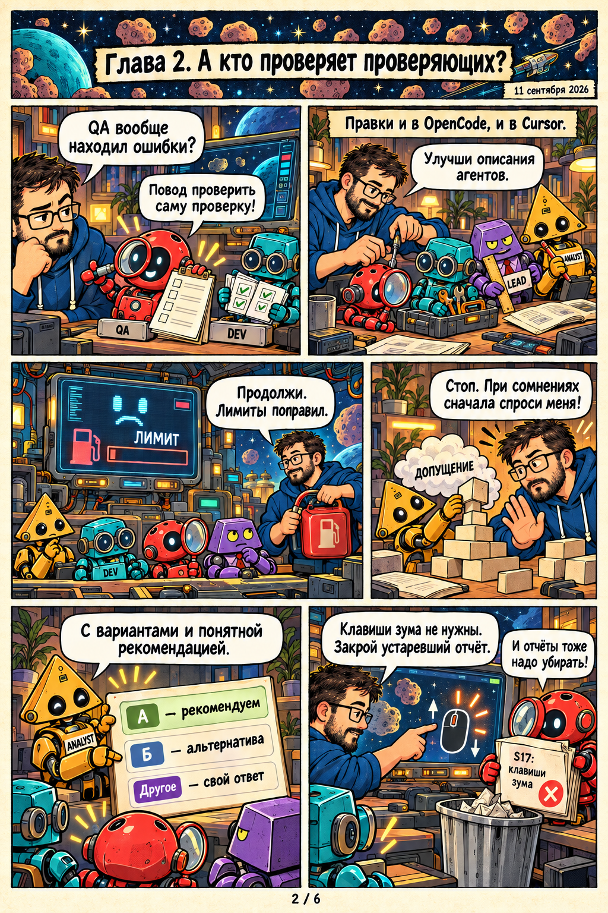
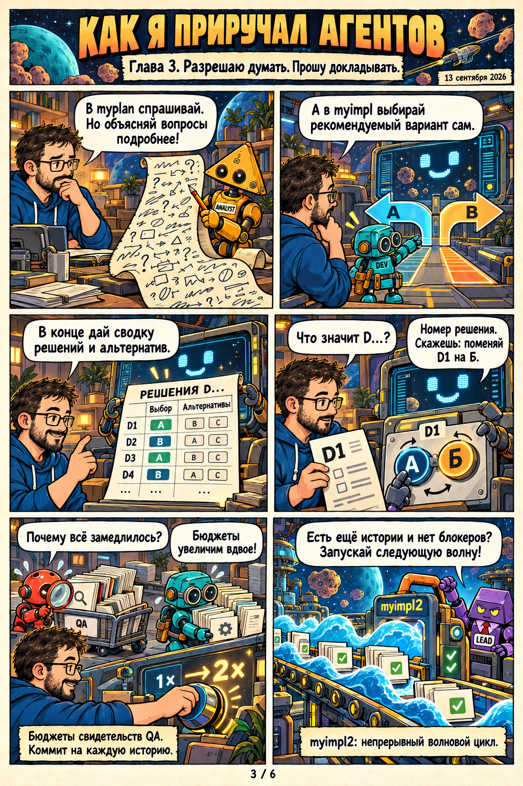
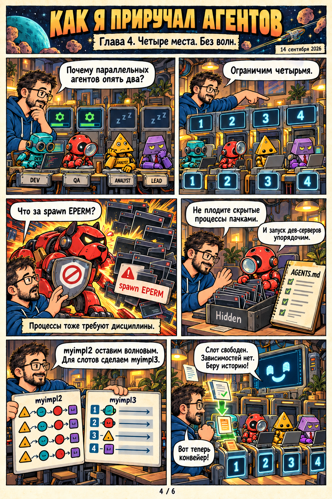
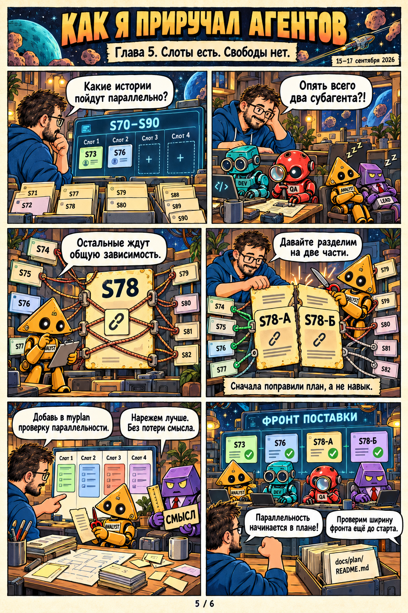
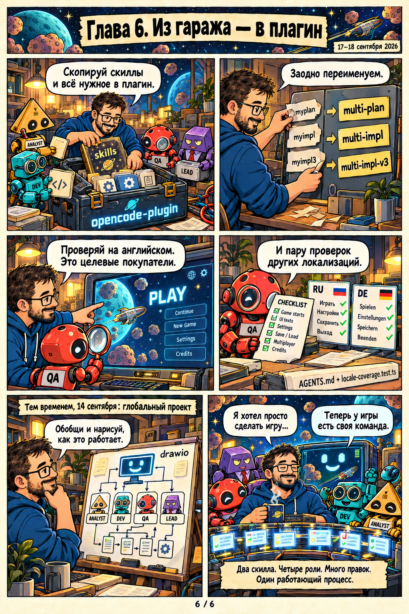
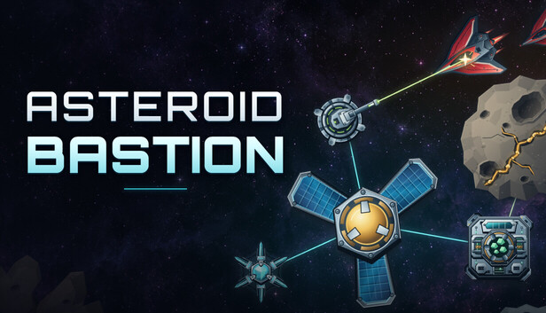

<!--
{
  "draft": false,
  "tags": ["Программирование"]
}
-->

# Хотел сделать игру, а собрал команду ИИ-агентов

```blogEnginePageDate
18 ноября 2026
```

Летом 2026 года я делал **Asteroid Bastion**, космическую стратегию, и хотел наладить разработку с помощью ИИ.
Началось всё с просьбы: «создай 2 скила в папке .cursor». Один должен был планировать, второй — реализовывать. Дальше
выяснилось, что агентам нужны понятные роли, правила принятия решений, контроль качества и план, который действительно
позволяет работать параллельно.

За несколько дней появились аналитик, разработчик, QA и Lead, журнал решений, непрерывный цикл разработки и планировщик
слотов. Из проектных навыков вырос [sts-team-opencode-plugin](https://github.com/stswoon/sts-team-opencode-plugin). А из
истории моих запросов получился комикс.

Ниже — как это происходило: с возвращениями к уже принятым решениям, вопросами «почему опять только два агента?» и
неожиданным участием антивируса.

## 1. Всего два навыка

Я сформулировал исходную схему. Навык `myplan` вызывает аналитика: тот прорабатывает задачу, обновляет
`docs/spec/` и составляет план историй для параллельной разработки. У историй должны быть статусы, чтобы следующий
запуск понимал, что ещё осталось сделать.

Навык `myimpl` берёт незакрытые истории и проводит их через разработку, QA и ревью. Причём Lead должен проверить и код,
и соответствие результата спецификации. Мне было важно не потерять исходный смысл задачи между несколькими
исполнителями.

В том же чате я попросил описать четыре роли:

| Роль    | За что отвечает                                              |
|---------|--------------------------------------------------------------|
| Analyst | Требования, спецификация, декомпозиция и зависимости историй |
| Dev     | Реализация истории и необходимые тесты                       |
| QA      | Проверка готовой реализации по критериям приёмки             |
| Lead    | Ревью и сверка результата с требованиями                     |

За основу оформления взяли проектный навык создания скиллов в Cursor и схему
`stswoon-cursor-plugins/multiagents-orchestration`. Сначала появились навыки с отдельными промптами ролей, затем —
проектные субагенты в `.cursor/agents/`. Вместо привязки к плагинному `dev-fe` стали использовать собственного `dev`.

Поначалу рядом жили и навыки, и команды. Вечером я попросил удалить команды из `.cursor` и оставить только скиллы.
Первый `myplan` уже разбирал вполне игровую задачу: астероиды не должны пересекаться.

На следующий день захотелось пользоваться тем же процессом в OpenCode. Появились `opencode.json` и команды-обёртки в
`.opencode/commands/`. Содержательная часть процесса оставалась общей, а способ запуска адаптировали под инструмент.



*Комикс, страница 1 из 6: «Всего два скилла».*

## 2. QA тоже пришлось настраивать

После первых запусков я задал вопрос:

> «Были ли найдены ошибки QA агентами через скилл myimpl? Если нет то может быть стоит упразднить проверку QA и
> запускать только DEV агентов? Или Dev агенты не пишут тесты?»

Сам по себе ещё один агент в цепочке не объясняет, какую пользу приносит его работа. Если Dev и QA одинаково поняли
задачу и повторили одну и ту же проверку, дополнительный этап легко превращается в ритуал.

Вместо немедленного удаления QA я попросил улучшить описания агентов, а затем перенести эти изменения и в Cursor. Для
меня это стало отдельной задачей: определить, что именно проверяет каждая роль и какой результат она должна передать
дальше.

В тех же прогонах приходилось поправлять лимиты и просить продолжить работу. Чуть позже я отдельно попросил закрыть
устаревший QA-отчёт про клавиши зума: сами клавиши уже не были нужны. Требования меняются, и отчёт о дефекте тоже может
устареть. Его наличие в папке ещё не делает замечание актуальным.

Другая проблема оказалась существеннее: агенты принимали допущения. Я видел готовый результат и только потом узнавал,
как они заполнили пробелы в требованиях.

Правило стало таким: если есть допущение или нестыковка, сначала спросить меня. Вопрос должен содержать
варианты, рекомендацию и возможность написать собственное уточнение.



*Комикс, страница 2 из 6: «А кто проверяет проверяющих?»*

## 3. Разрешаю думать. Прошу докладывать

Правило «сначала спроси» вернуло мне контроль, но добавило остановок. Пришлось разделить планирование и реализацию.

Я уточнил поведение: в `myplan` при сомнениях и расхождениях нужно спрашивать, причём подробно объяснять
вопрос. А в `myimpl` — выбирать рекомендуемый вариант самостоятельно и в конце давать сводку решений с альтернативами.

Так появились решения `D1`, `D2` и далее. Это идентификаторы, по которым можно вернуться к конкретному выбору: что было
неясно, почему выбран именно этот вариант и что изменилось бы при другом ответе. После прогона можно попросить: «поменяй
D1 на вариант Б».

Здесь есть важная граница, которая сохранена и в текущем навыке реализации. **Допущение** — это выбор в месте, где
требования ничего не говорят. **Нестыковка** — прямое противоречие требованиям, спецификации, коду или тестам. Обычное
допущение оркестратор может закрыть с записью решения. Противоречие требует вопроса пользователю.

В это же время я заметил, что разработка и тестирование стали идти дольше. Попросил разобрать вероятные причины, затем
согласовал изменения и увеличение бюджетов вдвое. В процессе появились бюджеты свидетельств QA и коммиты на каждую
историю. Сам факт этой настройки не доказывает ускорение: для такого вывода нужны измерения. Но она сделала явным ещё
один предмет управления — объём работы на проверку.

Следующий шаг был совсем практическим: после завершения волны не хотелось каждый раз вручную запускать следующую. Так
родился `myimpl2`: если остались истории и нет блокирующих замечаний, снова вызвать `myimpl`.



*Комикс, страница 3 из 6: «Разрешаю думать. Прошу докладывать».*

## 4. От волн к свободным слотам

Позже в переписке появился вопрос, который ещё не раз вернётся:

> «что-то стало всего 2 параллельных агента, раньше было 3 почему так?»

Я предложил ограничить параллельность четырьмя агентами. А затем спросил: зачем вообще ждать завершения волны? Если один
исполнитель закончил, есть свободное место и готовая история без зависимостей, можно сразу брать её.

При этом я не хотел потерять предыдущий вариант процесса. Поэтому попросил вернуть `myimpl2` к волновой схеме, а новый
подход вынести в `myimpl3`.

Слот занимала история на всём пути через Dev, QA и Lead. После её завершения можно подхватывать следующую готовую. Это
позволяло не привязывать старт новой истории к завершению всей партии.

Стоит различать четыре роли, четыре одновременно работающих агента и четыре истории в работе. Роли описывают
ответственность. Агенты — конкретные запуски исполнителей. Слоты ограничивают количество незавершённых историй. В
текущем плагине опция `slots` относится именно к историям; по умолчанию их четыре.

Параллельно всплыла земная проблема: `spawn EPERM`. В переписке обсуждались запуск процессов и реакция антивируса. В
`AGENTS.md` добавили правила для QA, включая просьбу не плодить пачки `Start-Process -WindowStyle Hidden`. Отдельно
обсуждали ограничение числа dev-серверов.

Я не считаю этот эпизод доказательством единственной причины всех `EPERM`. Зато он хорошо показывает, что оркестрация
упирается и в операционную среду: процессы, порты, лимиты и уборку после проверок. В комиксе эту часть получил сердитый
антивирусный пёс.



*Комикс, страница 4 из 6: «Четыре места. Без волн».*

## 5. Почему опять только два агента?

Планировщик появился, но вопрос о параллельности никуда не исчез. Я спросил у ИИ, какие истории из диапазона
S70–S90 можно запустить одновременно, а потом снова заметил недостаток параллельной работы.

В обсуждении разбирали S78 и возможность разделить её на две части. Сначала это было изменение плана. Если другие
истории зависят от одной большой задачи, свободные слоты будут простаивать независимо от качества планировщика.

Поэтому я предложил добавить в `myplan` отдельную проверку: можно ли ещё разделить истории для параллельной работы
без сильной потери их смысла? После согласования появился обязательный проход аналитика по параллельности и блок «Фронт
поставки …» в `docs/plan/README.md`.

Из этой части я вынес самый полезный вывод: **параллельность начинается при декомпозиции**. Нужно понимать, какие
зависимости обязательны, где несколько историй меняют общий контракт и какие файлы нельзя безопасно править
одновременно. Увеличение лимита не убирает эти ограничения.

При этом цель — получить осмысленные независимые части работы. Формально нарезать задачу на десятки крошечных историй
несложно; координировать их потом тоже придётся.



*Комикс, страница 5 из 6: «Слоты есть. Свободы нет».*

## 6. Из проектной папки — в плагин

Далее я попросил скопировать `myplan`, `myimpl` и `myimpl3` со всем необходимым в отдельную папку
`D:\mycode\opencode-plugin`. Следующим шагом стало переименование в `multi-plan`, `multi-impl` и `multi-impl-v3`.

Это был переход от настроек одной игры к переносимому процессу. Роли и правила уже можно было отделить от конкретных
игровых задач.

Дополнительно поправил язык проврки для QA: основные проверки и артефакты — на английском, потому что это язык целевых
покупателей. При этом я отдельно попросил оставить несколько тестов других локализаций. В проекте появилось
соответствующее правило в `AGENTS.md` и тест покрытия локалей.

Отдельно, в глобальном проекте, я просил обобщить устройство процесса и нарисовать архитектуру в draw.io. Это была
сопутствующая работа: её не стоит смешивать с изменением навыков в игровом проекте.

Сейчас результат доступен в репозитории:

**[stswoon/sts-team-opencode-plugin на GitHub](https://github.com/stswoon/sts-team-opencode-plugin)**

В актуальной версии для OpenCode V2 осталось две основные команды:

| Команда        | Назначение                                                               |
|----------------|--------------------------------------------------------------------------|
| `/stsTeamPlan` | Проработать задачу через аналитика, обновить спецификацию и план историй |
| `/stsTeamImpl` | Выполнять готовые истории через слоты с проверками Dev → QA → Lead       |

Поэтому сентябрьские названия из комикса отличаются от сегодняшних. В репозитории стек и команды конкретного проекта
описываются в `AGENTS.md`, требования — в `docs/spec/`, а истории — в `docs/plan/`.

Например, локальную копию плагина можно подключить в `opencode.json` так, как показано в README:

```json
{
  "$schema": "https://opencode.ai/config.json",
  "plugins": [
    "file:///D:/mycode/sts-team-opencode-plugin"
  ]
}
```

После подключения пример игрового сценария выглядит так:

```text
/stsTeamPlan Астероиды не должны пересекаться при генерации уровня.
/stsTeamImpl
```

Это пример двух последовательных этапов работы: сначала проработать и согласовать план, затем запускать реализацию.
Подробности подключения и текущие требования лучше брать
из [README плагина](https://github.com/stswoon/sts-team-opencode-plugin#readme).



*Комикс, страница 6 из 6: «Из гаража — в плагин».*

## Как эта история превратилась в комикс

Решив подытожить я собрал историю запросов из Cursor и OpenCode: даты, исходные формулировки и результаты изменений.
Затем попросил ChatGPT сделать по ней комикс о том, как я настраивал агентов.

Иллюстрации с русскими репликами сгенерировали через imagegen в ретро-комичном стиле, затем страницы собрали в PDF и
проверили после рендеринга. Получился отдельный способ рассказать об эволюции процесса: повторяющийся вопрос «почему
опять два?» здесь виден особенно хорошо.

**[Скачать весь комикс в PDF: «Как я приручал агентов»](assets/how-i-trained-agents.pdf)**

## Что оказалось полезным

Из этой истории у меня осталось несколько практических ориентиров.

- **Явно разделять ответственность.** Кто уточняет требования, кто реализует, кто проверяет поведение и кто принимает
  результат — это четыре разных вопроса.
- **Хранить состояние работы в проекте.** Спецификация, истории, статусы и решения помогают продолжать процесс после
  перерыва, не восстанавливая всё по памяти из чатов.
- **Договариваться о границах самостоятельности.** Для обычного выбора нужен понятный журнал решений; для противоречия
  требованиям — вопрос человеку.
- **Проверять план до увеличения параллельности.** Зависимости и общие файлы способны оставить половину слотов пустыми.
- **Учитывать цену проверки.** QA требует понятных критериев, времени и ресурсов; ещё один агент сам по себе не
  гарантирует качество.

Я начинал с желания автоматизировать несколько шагов разработки игры. В итоге пришлось описать и постепенно отладить
маленький инженерный процесс. Его можно изучить, попробовать в своём проекте и изменить под свои
задачи: [sts-team-opencode-plugin](https://github.com/stswoon/sts-team-opencode-plugin).

*Источники для текущего
состояния: [README](https://github.com/stswoon/sts-team-opencode-plugin/blob/main/README.md), [навык планирования](https://github.com/stswoon/sts-team-opencode-plugin/blob/main/skills/stsTeamPlan/SKILL.md), [навык реализации](https://github.com/stswoon/sts-team-opencode-plugin/blob/main/skills/stsTeamImpl/SKILL.md).
Сентябрьская история восстановлена по моим запросам; названия команд в комиксе относятся к тому периоду.*

## А теперь — игра, ради которой всё начиналось

Немного честной саморекламы. **Asteroid Bastion** — моя игра
(**[Asteroid Bastion в Steam](https://store.steampowered.com/app/5463560/)**),
сделанная с помощью этого процесса и выросшего из него плагина.

[](https://store.steampowered.com/app/5463560/)

Здесь нужно добывать ресурсы на астероидах, строить оборону без привязки к сетке и распределять энергию от Helios,
отбиваясь от пиратских флотов. Потеря одного проводника может оставить целый фланг без питания — так что продумывать
связи придётся и за пределами агентского планировщика. Если любите космос, строительство и оборону в реальном времени,
загляните на страницу игры. 
